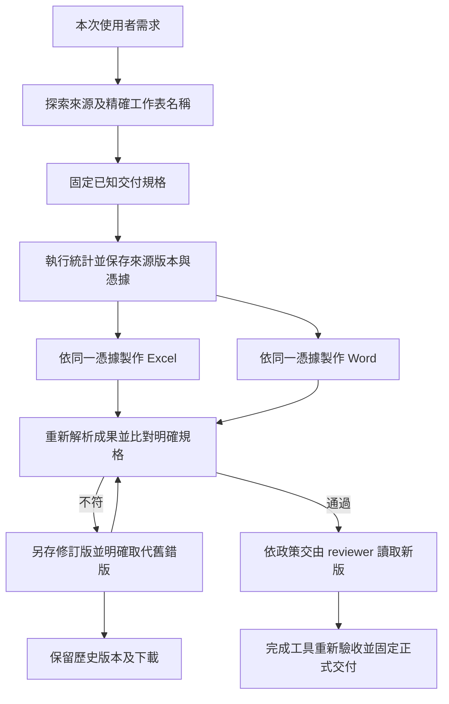

# Company Agent 工作流程優化設計

本次改動針對 2026 年 10 月 17 日比較測試中的成果版本、統計交接、工具錯誤與交付可靠性問題。主要原則是讓工具結果、來源版本與交付規格成為可驗證的條件，並以可選執行模式減少例行工作的角色交接。

後續新增 v27「專責 Office 分工」，用工具權限、委派範圍及原子派工保留處理主協調與製作者的責任重疊。下方 v26 付費測試仍是歷史結果，不當作 v27 新政策的模型效能證據；正式環境尚未切換。

既有來源權限、本人計費、模型呼叫總額度、外部寫入核准、原檔保留與獨立審核要求繼續生效。混合模型配置是可測試的候選方案，實測結果另列於驗證報告。

## 執行流程



沒有產檔需求的工作不建立交付文件。互不依賴的閱讀或製作可並行；統計和依該統計製作文件之間必須等待結果。

## 成果版本與正式交付

`artifacts.lifecycle` 包含 `draft`、`superseded`、`final`，舊版以 `superseded_by` 指向替代版本。新增版本不覆寫舊檔內容。

`supersede_artifact` 必須提供新舊成果的真實 ID 與 SHA256。伺服器核對相同擁有人、工作、格式與內容雜湊，在交易中取代有效草稿。重複相同轉換不產生第二次變更；競爭取代只有一個成功，不允許循環、已交付版本變動或舊稿重新成為有效版本。

不同的有效成果不能共用檔名。模型須明確選擇哪一版取代哪一版；不能依檔名猜測或默默省略。已登記規格要求保留的檔名，不允許由不同檔名取代。因此「保留 draft.pptx 並另存 revised.pptx」仍須交付兩份。

完成清單必須恰好等於全部有效成果。每個有效版本保留既有的雜湊與獨立讀取回條檢查；舊版回條不適用新版。完成交易會固定本工作的交付狀態，阻止延遲完成的工具再新增成果。

工作台與聊天下載清單只列有效成果；工作台另外提供「已取代的歷史草稿」下載區。歷史檔案仍受相同擁有人與工作範圍檢查。

## 交付規格與統計憑據

`plan_delivery` 在產檔前登記明確檔名、工作表順序、儲存格值、必要文字與統計來源範圍。規格持久保存在工作資料庫，同工作不能放寬或改寫；要求變更時另開工作。相同規格的重送可安全重用。

登記工具先檢查 XLSX 必須使用 cells、Word 等文字文件必須使用 texts，避免規格本身在產檔後才被判定不支援。對明確產出敘述中的 ASCII 檔名及以引號標示的 Unicode 檔名，工具也會檢查完整清單，避免漏列下一個角色要做的文件；參考／來源敘述不列為產出。

對「交付檔名＋工作表＋A1=合計／B1=合計值」這類成對欄位，登記工具會核對原始使用者要求，攔截漏列儲存格、把標籤格綁成數值或把統計值當文字的規格。引號內的文字可作精確字串檢查；空白、未成對的數值描述等歧義詞不自動轉成文字。未辨識的一般敘述仍交由語意審核，不以字詞推測產檔權限或來源。

正式 Service 入口對通用檔案產製與草稿修訂啟用 `require_delivery_plan`；EIP 行程等專用流程沿用其具型別的領域規格與核准流程。直接使用 Python `Settings` 時維持向後相容的可選設定。協調、文件、資料與工程草稿角色均可登記規格，以便專責角色在收到工具回饋後修正；已有伺服器規格時仍不能改寫。必須登記原需求中的完整交付清單，不能只登記被委派的一份。

可信呼叫端也可直接傳入結構化規格，不依賴模型抽取：

```python
await agent.run(owner, instruction, delivery_plan={
    "statistics": [{
        "key": "values", "root": "project", "path": "source.xlsx",
        "sheet": "工程", "column": 1, "start_row": 1, "end_row": 3
    }],
    "files": [{
        "name": "checked.xlsx", "sheet_names": ["結果"],
        "cells": [
            {"sheet": "結果", "cell": "A1", "expected": "合計"},
            {"sheet": "結果", "cell": "B1",
             "statistic": {"key": "values", "metric": "sum"}}
        ]
    }]
})
```

`analyze_spreadsheet` 實際成功後，伺服器保存不可改寫的 `statistics_evidence`：工具呼叫 ID、來源 root/path/SHA256、工作表、欄與列範圍、sum/count/min/max/mean、排除類別筆數與演算法版本。原本平面的統計欄位仍保留，方便既有工具使用者。

後續委派可用 `requires_evidence` 指定本工作真實憑據。不存在或其他工作的 ID 不會啟動子角色；成功時子角色收到結構化結果，無須從摘要抄數字。已登記的統計交付工作在產檔前也會檢查必要工具是否真正執行。

產檔與最後交付前重新核對引用來源的當前權限及雜湊。來源變更或權限撤銷會停止；不悄悄改採另一版本、另一來源或公式快取。

## 程式化驗收

`validate_delivery` 與 `complete_job` 會重新讀取有效成果。內容解析使用既有受資源限制的 parser 子程序，避免在主服務中開啟任意 Office 封裝。

| 規則 | 驗證方式 |
| --- | --- |
| 必要交付檔案 | 精確檔名與有效版本存在；不能出現同名有效成果 |
| 工作表 | 精確名稱及順序 |
| 指定儲存格 | 字串、布林、數值或空值比對；布林不能冒充數值 |
| 統計儲存格 | 對照真實來源與範圍的工具憑據；公式與未驗證快取不能代替常數結果；保留原公式時以 `formula=true` 精確核對公式字串，不宣稱計算結果已驗證 |
| Word 等文字內容 | 對照指定文字；統計文字以 `{value}` 代入同一憑據的數值 |
| 來源完整性 | 沿用來源 SHA 與精確修改工具的檢查；原檔不覆寫 |
| 審核 | 有效成果的新 ID 與 SHA 必須取得政策要求的 reviewer 實際讀取回條 |

儲存格中的「筆數」採精確字串比對，可攔截額外的零寬字元或其他字元；不對所有資料做破壞性的 Unicode 清洗。驗收回條綁定實際成果 ID 與 SHA。

程式只驗證已登記規格。模型從自然語言抽取規格的完整性、Word 文字的整體語意、簡報版面與工程判斷仍需對應評測或人工驗收，不能從檢查通過推論全部正確。程式驗收不代替既有獨立審核或本人存檔核准。

## 可修正的工具錯誤

工作表不存在時，parser 回傳 `sheet_not_found` 及真實 `available_sheets`；已授權來源不存在時，回傳 `source_not_found`。錯誤不攜帶子程序 traceback、主機路徑或憑證。

只有明確分類的可修正問題會回到模型工具迴圈。ACL、來源版本、損壞文件、資源限制、未啟用功能及不明操作結果仍維持停止行為。沒有通用的自動重試、來源替換或外部寫入重送。

模型可修正名稱、補登記規格、補正完成清單及安排新版審核，或如實回覆缺資料／受阻。使用者明示尚缺的欄位須逐項保留，本機或系統預設不能視為已提供，例如事件時區不能以本機台北時間代替。必要檢查不因回饋而放寬。

先前子任務受阻後，可由協調者以 `resolves_assignments` 明確補做同角色的未完成工作；只有新子任務實際成功後才解除對應阻礙，其他獨立任務不受影響。這些呼叫持續計入同一份模型總額度，恢復工作不會重設。

## 執行模式與模型設定

| 模式 | 工具與適用範圍 |
| --- | --- |
| `delegated` | 保留專責角色分工；協調者增加交付規格、驗收與版本管理工具 |
| `hybrid` | `flexible` 時協調者可直接讀取、計算及製作 Office；`specialist` 時只直接搜尋／讀取，統計與製作交專責角色 |
| `chat` | 短提示詞及完成工具；不探索來源、不委派、不提供檔案與外部操作工具 |

EIP、網路、CAD、OCR、圖片與存檔申請繼續由專責角色處理。混合模式不授予主協調外部寫入能力，也不能用自我讀取取代強制 reviewer。

模式由伺服器設定，在工作開始前固定，沒有額外路由模型呼叫。這一版不以關鍵字推測任意使用者需求，也不在同一工作中自動切換模式。新增模式與交付規格政策都寫入 checkpoint；恢復時變更會被拒絕。

### v27 專責 Office 分工

`office_execution_mode` 可選 `flexible`（Python Settings 向後相容預設）或 `specialist`（兩份優化範例採用）。與 chat／hybrid／delegated 分開設定，不引入另一層路由模型，也不變更固定的角色模型。

specialist 必須啟用 `structured_completion=true`；公開執行入口在建立工作、儲存或模型設定前拒絕不相容組合，直接建立 graph 也有相同檢查，避免一般文字回覆繞過子任務產出與修訂驗證。

| 角色 | specialist 模式中的責任 | 混合模型候選 |
| --- | --- | --- |
| coordinator | 理解需求、搜尋／讀取、指定產檔負責人、安排依賴、驗收與整合；移除 Office 產製及統計工具 | Lite |
| data | Excel 讀取、統計與 XLSX 產製／修改；只產出本次 outputs 指定檔案 | Argon |
| document | Word／PPT／TXT／MD／CSV 產製與修訂；依 data 真實憑據製作，不重算 | Lite |
| reviewer | 唯讀核對來源及新版成果；必要時重新計算屬獨立驗證，不製作另一份成果 | Lite |
| knowledge／research／engineering／eip | 維持檢索、公開研究、工程及企業系統邊界 | Lite |

一般全 Lite 範例的分工相同，只將 data 也設為 Lite。EIP 行程 CSV／附件、工程 DXF 等領域輸出維持既有具型別契約與核准機制，不要求模型預測它們的所有附件檔名。

每次委派帶入穩定 `work_key` 與 `outputs`。唯讀、純統計及 reviewer 填空清單。伺服器將角色與允許檔名注入子任務 Context，不由子模型自行宣告。產檔前再檢查角色與清單；子任務宣告完成時，核對實際產製回條、指定檔名及全部必要輸出，不允許拿其他角色已做好的檔案充作自己的成果。

例如先以 `excel_report`／data／`[checked.xlsx]` 完成統計及 Excel，再以 `word_report`／document／`[summary.docx]` 引用真實 `requires_evidence`，最後以 `review_delivery`／reviewer／`[]` 校核。主協調不另外做一份 Excel，文件角色不心算數字。

新增 `assignment_claims` 表，於短交易中序列化子任務與檔名保留，不將資料庫鎖跨過模型呼叫。相同 key、完全相同角色／任務／上下文／輸出規格，即使改 key 仍不啟動第二個子角色；不同描述但同名輸出也會阻擋，檔名衝突採 casefold 比對。原生相同 call_id 與相同參數可在 checkpoint／人工確認恢復時重入，參數變更則停止。

修訂使用新 work_key＋`revises_assignments`，只能引用本工作同角色、已 completed 且有實際產檔的前次委派。未完成的補做繼續使用 `resolves_assignments`。只有顯式引用目前檔名負責子任務，才可將同名輸出交給同角色的新工作；舊修訂引用不能搶回新版本的責任。修訂仍另存，不自動取代、不繼承 reviewer 回條；主協調須明確 supersede 舊版及安排新版審核。

這不是自然語言語意去重器：純閱讀工作若刻意同時改 task、context 與 key，仍可能重複閱讀；單一子任務內重複呼叫產檔工具也仍由版本與最終驗收攔截。不得宣稱消除所有模型重工。此政策優先解決跨角色重複製作、同一輸出重複派工，以及 Lite 主協調繞過 data Argon 的路徑；代價是小型產檔也增加一次專責交接，須另測延遲與費用。

`model_timeout_seconds` 設定預設單次請求時限，`ModelRoute.request_timeout_seconds` 可覆寫角色／用途／模型設定。時限會傳到實際 SDK HTTP 請求，與整份工作的 `execution_timeout_seconds` 及共用呼叫次數上限分開生效。沒有新增 provider 重試或 fallback。

[一般設定範例](../company_agent/configs/config.optimized.example.json) 保留 Lite 角色並提供混合模式；[混合模型候選](../company_agent/configs/config.mixed-candidate.example.json) 另示範 data Argon 與 150 秒請求時限，不作預設升級。角色配置仍在工作開始時固定；不能讓模型自行改扣費身分或替既有工作升級模型。每次模型呼叫另記錄延遲、角色與供應商回傳的模型名稱，供後續比較使用。

## 資料遷移與上線

遷移使用 PostgreSQL 加欄位及新增表格，舊 artifacts 預設為有效草稿，不猜測哪份舊檔應被取代。舊檔內容、核准與消費紀錄不刪除。

Graph 先由 25 更新為 26，本次專責分工再升為 27；工具 schema 與 checkpoint 政策已變更。新增 assignment_claims 表，不回填舊工作的派工責任。舊 checkpoint 保留下載，不能直接恢復至新版工具協定。Office 分工政策也寫入 checkpoint，恢復時不能切換。上線時先讓舊工作完成或停止，再一併更新／重啟服務與 parser，避免長駐父程序及新子程序混用不同協定。候選模式先在 dev 測試，正式模型路由不由評測器變更。

## 驗證與重現

v26 原始驗證：完整回歸共 560 項，546 項通過、14 項依環境條件略過；另有 4 項 gateway 設定測試通過。JavaScript 語法、Python 編譯、Ruff F／RUF059 與差異空白檢查亦通過。v27 專責分工驗證另列於下方，不將歷史付費成果混入新版本。

新增測試涵蓋錯字元標籤、跨檔數值、缺統計憑據、來源變更／權限撤銷、同名修正版、競爭取代、保留原稿、模式恢復、HTTP 逾時、歷史下載及混合流程的獨立審核。

比較器增加 `company_hybrid_lite`、`company_mixed`、`company_hybrid_data_argon`、`company_chat_lite`、`company_chat_argon`，預設四組比較不變。模型與工具仍使用已驗證使用者計費，測試只用合成檔案與可刪除的 PostgreSQL schema。正式 NAS／EIP 與外部寫入未納入此輪付費測試。

v27 另增加 `company_specialist_lite`／`company_specialist_data_argon`，分別與 flexible hybrid 及彼此做同案例配對，結果記錄 office_execution_mode。既有 arm 不改意義。

```bash
python -m company_agent.evals.comparison --output /tmp/optimization-manifest.json \
  --arms company_hybrid_lite company_mixed company_chat_lite company_chat_argon
```

評測工具、隔離設定、失敗紀錄與費用核對方式見[評測說明](../company_agent/evals/README.md)。不同版本與執行批次分開記錄，舊模型數據不作為目前版本的驗收證據。

### v27 分工驗證

新增 `test_office_ownership.py` 17 項測試，包含嚴格工具權限、模型候選配置、Service 設定傳遞、唯讀任務禁止產檔、缺少輸出禁止宣告完成、重複委派、並行檔名衝突、修訂與失敗補做、Excel→Word 真實統計交接及獨立審核、核准恢復與分工政策固定。初始化也驗證專責模式不能停用結構化完成。

完整回歸 578 項：564 通過、14 項依環境條件略過，零失敗／錯誤。最後的結構化完成初始化檢查補強後，49 項分工／架構／工具契約／工作台快照／比較器定向回歸全部通過，其中包含新增的 17 項分工測試；另 4 項 gateway 設定測試通過。Ruff F／RUF059、Python 編譯與差異空白檢查通過。測試使用相容的 WebUI Python 環境與可刪除的 PostgreSQL schema，未安裝或修改正式環境依賴。

新增四組 flexible／specialist × 全 Lite／data Argon 的離線比較 manifest，規劃 96 件工作且 paid_calls=0。這一輪沒有付費模型效能重測，沒有連接真實 NAS／EIP 或部署正式服務；不能將權限與流程測試通過當成模型必然選對分工、速度改善或費用降低的證據。
