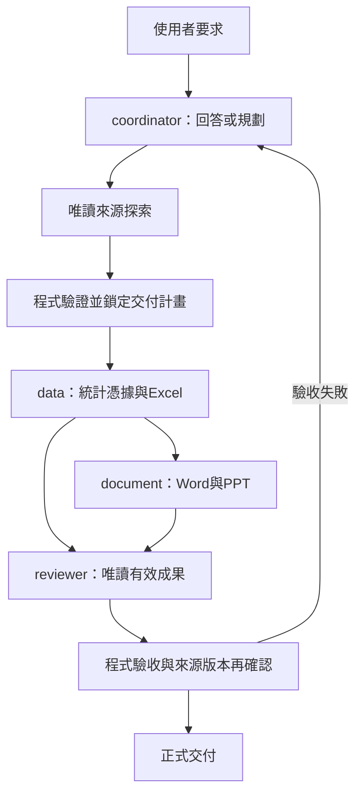

# Company agent：來源驗證與交付計畫設計（graph 29）

本版處理graph 28付費實測揭露的兩個交付計畫問題。實測與程式回歸分開記錄，尚在進行的批次不預先認定通過。正式服務未部署、未切換模型。

## 實測問題與修正

W03的Flash組第一輪，原簿實際只有「工程」「第二表」，協調者卻把英文別名second_sheet也寫入不可變計畫。資料修改與報告的主要內容可通過，但成果不可能同時保留原簿又滿足錯誤的第三張表，因此反覆產檔直到40次呼叫上限。

W02的Argon組第一輪，Word與PPT規格寫「合計：{value}」「筆數：{value}」，卻沒有指定statistic。驗收把預留符號當字面文字，正確數字的成果仍無法完成。兩者都保留原始失敗紀錄；不以事後放寬驗收補分。

| 問題 | 新版處理 | 保留的限制 |
| --- | --- | --- |
| 原簿工作表憑空出現別名 | 鎖定計畫前以實際已讀來源、權限與SHA重新讀取表名；有錯先退回修正；省略清單時由伺服器補齊 | 保留原簿的名稱與順序；不增加翻譯別名 |
| 不清楚哪一份是原簿 | 單一已讀XLSX可自動綁定；多來源必須明確base_source | 不猜路徑、SHA或來源版本 |
| 重建的工作簿冒充原簿修改 | 產檔工具必須是edit_spreadsheet，參數與計畫來源一致；驗收核對實際工具回條、成果ID與SHA | 原簿封裝保存及既有精確儲存格檢查仍執行 |
| 來源在工作途中改變 | 產檔、驗收與最終完成前重新核對來源SHA與可讀權限 | 不默認採用舊來源，也不自動改寫計畫 |
| 統計預留符號未綁定 | schema拒絕沒有statistic的{value}，要求有效key與metric | 真正統計工具憑據仍是驗收依據 |
| 使用者真的要字面預留符號 | 只有原始要求明確含{value}時，接受{{value}}轉義 | 不能把轉義當作跳過統計的方式 |
| 明確要求一段儲存格依同列標籤填統計 | 鎖定前檢查指定範圍每格皆綁定正確metric，攔截漏格或平均誤放最小格 | 僅處理可辨識的明確對應語法；模糊敘述仍須審核 |
| 新建統計報表 | 不套用原簿工作表限制，可使用明確規劃的新表名 | 仍須符合原始交付要求與統計憑據 |
| 外部注入交付計畫 | 原簿修改須提供base_source，建立工作及呼叫模型前實際驗證 | 身分與來源權限仍檢查，不接受任意偽造綁定 |

來源檔與下載成果可有相同檔名：它們屬於不同儲存位置。伺服器綁定完整root/path/SHA，不能只靠檔名推斷或覆寫來源。

原簿辨識採明確的edit_spreadsheet與另存／產出／輸出語法，或單一XLSX成果且明確要求保留／修改／沿用原簿。這是有界規則，不能宣稱理解所有自然語言的保留意圖。需求曖昧時應先確認；新建報表不應自行宣告原簿保留。

## 使用架構與角色

沿用LangChain agent迴圈、LangGraph持久化及工具式委派；hybrid編排加上specialist Office權限。coordinator可以直接回答一般問題、唯讀了解來源；Office產製由專責角色負責。角色可用不表示每件工作都啟動八個角色。

| 角色 | 工作與Office邊界 | 本次比較的模型 |
| --- | --- | --- |
| coordinator | 整理要求、唯讀來源、登記完整計畫、委派與最終驗收；不產製Office | gemini-3.5-flash-lite |
| data | Excel讀取、計算、原簿修改、公式、圖表與資料報表 | gemini-3.8-flash；對照gemini-4-argon |
| document | 根據實際數據憑據製作及修改Word／PPT | gemini-3.5-flash-lite |
| reviewer | 唯讀檢查有效最新版與來源；不能取代產製角色 | gemini-3.5-flash-lite |
| knowledge | 檔案探索與來源內容整理 | gemini-3.5-flash-lite |
| research | 明確需要時查公開來源 | gemini-3.5-flash-lite |
| engineering | 明確需要時處理工程來源 | gemini-3.5-flash-lite |
| eip | 明確需要時使用授權企業系統 | gemini-3.5-flash-lite |

典型依賴為「來源探索 → 驗證並鎖定計畫 → data真實計算／Excel產製 → document使用同一憑據 → reviewer檢查有效成果 → 程式驗收 → 最終完成」。獨立探索可並行，有數據依賴的文件須等待。work_key及outputs限定產製責任；草稿版本與有效交付分開。

驗收失敗時回到協調者安排修訂與新版審核；已鎖定的使用者規格不會因失敗而放寬。

一般聊天可直接完成；單一Excel由data連續完成；跨格式任務依真正依賴拆分。這套設計能支援由簡到繁的編排，但支援的任務種類、資源上限與實測通過率必須分別說明。Office合成測試不代表NAS、EIP、工程圖片、公開查詢或大規模並行已驗收。

## 驗證與部署邊界

新增真實PostgreSQL回歸涵蓋錯誤表名退回後修正、完整跨角色流程、來源版本與權限變更、多來源歧義、偽造回條、正確原簿修改、新建報表、同檔名不同位置及注入計畫。既有完整測試另行執行，付費結果以獨立批次保存。

graph版本升為29。舊checkpoint不得直接以新版規則續跑；原版工作可在原版完成，或確認來源後另開新版工作。舊成果依既有擁有權仍可匯出。本次未自動遷移、部署或重啟服務。

[前版設計](company-agent-reliability-v28-design-2026-10-18.md)說明版本交易、列數限制、錯誤恢復、原始104件案例與替換門檻。模型名稱使用本工作區gateway的實際路由ID，不據此推論供應商公開產品規格。

Office候選設定另存為[Flash版](../company_agent/configs/archive/config.office-v29-flash.example.json)與[Argon版](../company_agent/configs/archive/config.office-v29-argon.example.json)。兩份只有data模型不同，條件均為40次呼叫、300秒請求、600秒工作、medium及4096 tokens；交付計畫與獨立審核必須啟用。roots與state_dir需依實際來源設定。它們不會自動套用到服務，正式設定本次未修改。
