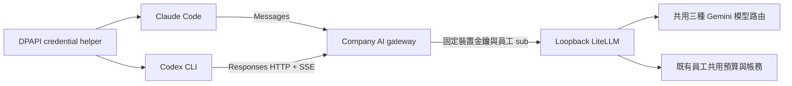
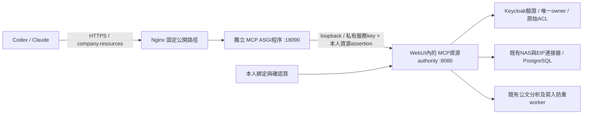
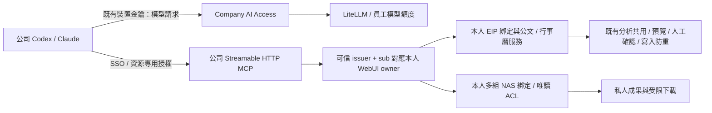
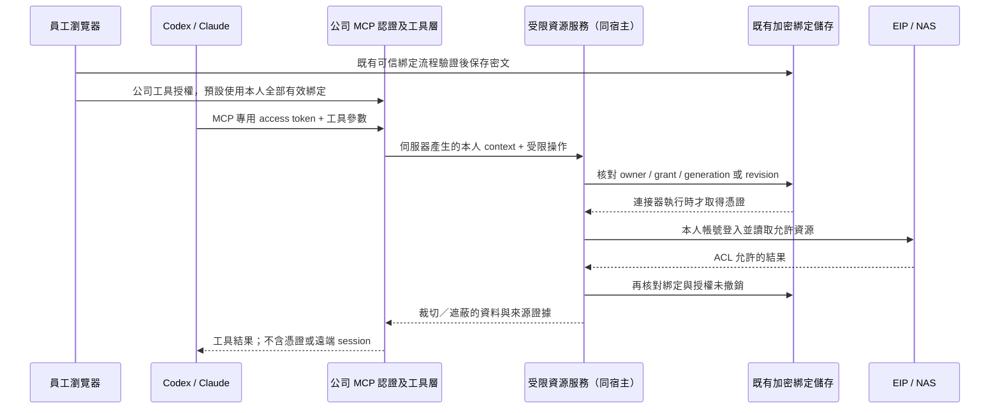
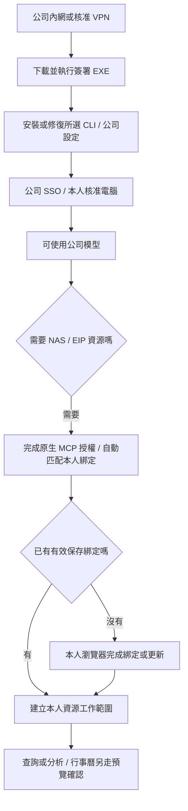

# 公司 Claude Code／Codex CLI 整合設計

> 2026-11-15：MCP已改為獨立 ASGI程序，採官方 `MCPServer`，由固定私有介面使用既有資源後端；預設停用，尚未部署。
> 目前程式入口與啟用步驟見「NAS／EIP MCP 實作與啟用」；其後原始設計保留供追溯，
> 尚未完成的進階能力以實作節的限制為準。五模型仍維持候選準備狀態，正式模型權限未變更。

2026-10-24，來源版本 1.1.8（預設兩種工具，自動安裝缺少的工具，已安裝者略過下載與安裝）。CLI 維持 0.164.0。測試見 `company-ai-default-install-validation-2026-10-24.json`；先前安裝／核准／啟動修正的歷史證據保留於各部署紀錄。

## 使用方式

預設安裝並設定 Claude Code 與 Codex；只安裝缺少的工具：

```powershell
.\Setup-CompanyAI.ps1 -Portal https://changdar-server.mooo.com
```

明確選擇單一工具：

```powershell
.\Setup-CompanyAI.ps1 -Portal https://changdar-server.mooo.com -Tools Claude
.\Setup-CompanyAI.ps1 -Portal https://changdar-server.mooo.com -Tools Codex
```

既有安裝開關維持相容：單獨 `-InstallClaude` 選 Claude、單獨 `-InstallCodex` 選 Codex，兩者並用選 Both。一般設定不再需要安裝開關。明確指定 `-InstallClaude:$false` 或 `-InstallCodex:$false` 可禁止自動安裝該工具；維護模式 `-RefreshModelsOnly`／`-RepairPathOnly` 不安裝工具。
已安裝者略過下載與安裝，繼續公司設定；Codex 仍驗證公司核准版本。版本不符時停止交由 IT 更新，不自動移除個人套件。
兩種工具完成同一次公司瀏覽器核准，共用該電腦的受限裝置金鑰與員工預算。
1.1.5 起，先透過 LAN/VPN 限制的 `/company-ai/v1/codex/install-policy` 取得公開安裝版本，
完成 Codex 安裝／版本驗證後才建立核准請求。安裝再久也不消耗 10 分鐘核准或 5 分鐘交付 ACK 期限。
該端點只回傳 allowed、codex_enabled、codex_release，不含 catalog、身分或憑證；
原 `/company-ai/network-access` 契約保持不變。取得金鑰後只驗證已準備的版本，不再下載 CLI。
ARM64 員工已完成 CLI 0.164.0 安裝，但舊流程 ACK 逾期；證據見 `company-ai-codex-activation-validation-2026-10-24.json`。
1.1.3 起，native `device/start` 回傳 `codex_enabled`。選擇 Codex／Both 時，
PS1 在開啟核准頁前檢查此欄位：缺少代表後端版本落差，false 代表後端未啟用。
兩者都會停止；只建立待核准請求，不進行瀏覽器核准、不發放裝置金鑰。Claude 單獨設定維持相容。

設定完成後，完整關閉並重開終端機，再執行 `claude` 或 `codex`。
安裝器將此 Windows 帳號的 User `CODEX_HOME` 指向公司 home；個人設定檔保留原樣。
新開啟且繼承此環境的 Codex CLI、IDE extension 與 app-server 都會使用公司 home。
舊的 `company-codex` 保留相容性，日常使用 `codex` 即可。
Codex 的 `/model` 選單與 Claude 使用同一份三模型清單，預設都是 Gemini 3.8 Flash：

| 模型 ID | 顯示名稱 | Codex 推理預設 |
| --- | --- | --- |
| `gemini-3.8-flash` | Gemini 3.8 Flash | `low` |
| `gemini-3.5-flash-lite` | Gemini 3.5 Flash Lite | `none` |
| `gemini-4-argon` | Gemini 4 Argon | `medium` |

Flash 與 Argon 提供 `low`、`medium`、`high` 選項。也可指定單次啟動的模型：

```powershell
codex -m gemini-3.8-flash
codex -m gemini-3.5-flash-lite
codex -m gemini-4-argon
```

選擇 `Codex` 不需要先安裝 Claude，也不會改寫 `.claude/settings.json`。

```powershell
.\Setup-CompanyAI.ps1 -Portal https://changdar-server.mooo.com -Tools Codex -RefreshModelsOnly
.\Setup-CompanyAI.ps1 -Portal https://changdar-server.mooo.com -Tools Both -RepairPathOnly
```

已設定過公司 Codex 的電腦，可用新版 PS1 執行下列指令切換為直接呼叫 `codex`，不重新綁定、不更換金鑰：

```powershell
.\Setup-CompanyAI.ps1 -Portal https://changdar-server.mooo.com -Tools Codex -RepairPathOnly
```

`-RepairPathOnly` 使用既有安裝紀錄檢查 CLI 版本，補上原生 CLI 的 PATH，並設定公司 `CODEX_HOME`。
模型更新也會補上這項設定，不建立新裝置、不更換金鑰。CLI 核准版本改變或到達瀏覽器確認期限時，應完成更新／重新執行一般設定。
同時維護兩種工具時使用 `-Tools Both`。公司／個人模式的選擇是使用便利性；此安裝器不取代企業強制政策。

## 架構與資料流



既有 OIDC、PKCE、裝置核准、30 天 lease／90 天確認上限、LAN/VPN、權限快取、停權與撤銷機制沿用。
無須為 Codex 新建員工帳號、另一套預算或發放 provider/master key。

新增路由：

| 路由 | 用途與權限 |
| --- | --- |
| `POST /company-ai/v1/responses` | 裝置憑證、LAN/VPN、與 Claude 共用模型白名單；只轉送固定 loopback LiteLLM `/v1/responses` |
| `GET /company-ai/v1/codex/config` | 同一驗證，交付已核准版本、模型、完整 catalog 與公司 API base；不含金鑰 |
| `GET /company-ai/downloads/Start-CompanyCodex.ps1` | 與既有下載相同網路政策；固定檔名白名單 |

`/v1/models` 與 Codex config 使用相同模型、順序與預設；Codex catalog 保留三種模型各自的推理設定。
瀏覽器 `/policy` 增加 `codex_enabled`、`codex_models`、`codex_release`，供公司網站顯示工具選項。
核准網頁已提供工具選擇；Codex 尚未啟用時選項停用。
Flutter 契約為相容的新增欄位，無須讓瀏覽器接觸交付金鑰。

## 協定、權限與計費

Responses 採無狀態 HTTP：保留完整重播 input、function/custom tool call、call ID、工具結果與 reasoning item。
SSE 以區塊轉送，保留完成／失敗事件、不緩衝整段回答；關閉串流時關閉上游連線。
不開啟 WebSocket、遠端搜尋、MCP hosted tools、file search、背景執行或伺服器 conversation storage。
`store` 固定 false，拒絕 `previous_response_id`、conversation 與 item reference；不提供讀取／刪除其他 response 的路由。
自訂 provider 使用 CLI 的本機重播／壓縮路徑，不開放 `/responses/compact`。
長對話的本機壓縮仍列入各個正式 CLI／模型組合的 Windows 驗收。

允許本機 function/custom tools，以及其 namespace。禁止會由上游執行或連線的內建 hosted tools。
影像只接受指定格式的 inline data URI；檔案 ID、遠端影像 URL 不在此入口的支援範圍。
頂層 request 欄位採白名單，丟棄 `api_key`、`api_base`、provider overrides、任意 metadata 與自訂身分欄位。
服務重新設定 `user`、`metadata.user_id`、`litellm_metadata.user` 和 `x-litellm-customer-id` 為已驗證裝置的 Keycloak sub。
非成功 HTTP 回應保留可診斷的狀態與公司錯誤代碼，隱藏上游錯誤內容。
Codex 未指定輸出限制時，gateway 將單輪 `max_output_tokens` 設為 8192（包含模型思考預算）；
明確提供的輸出限制仍會保留。避免使用供應商過大的預設輸出預算。

LiteLLM 新金鑰只允許兩種工具共用的模型白名單，以及精確推論路由。
裝置記錄同時保存核准時的 Codex 能力；既有 Claude 裝置必須重新綁定，才能使用新入口。
**不傳 `key_type=llm_api`**：實測該欄位會把明確 `allowed_routes` 改為較廣的 `llm_api_routes`。
重新交付同一 provisioning 金鑰時，也比對實際模型與路由。原本已啟用的金鑰不在背景擴權；升級後由一般裝置重新綁定取得新金鑰。
共享預算仍有既有串流／並行請求的結算時間差，不保證精確硬上限。

## Windows 檔案與交易行為

檔案位於 `%LOCALAPPDATA%\CompanyAI\<portal-host>`，沿用員工 ACL 與 current-user DPAPI。

| 檔案 | 內容 |
| --- | --- |
| `credential.dpapi` | 加密的裝置金鑰 |
| `device.json` | Portal、裝置 ID、確認期限、已設定工具；不含金鑰 |
| `Get-CompanyAIKey.ps1` | Claude `apiKeyHelper`／Codex provider auth 共用，只在 stdout 輸出金鑰 |
| `Start-CompanyCodex.ps1` | 舊指令相容 launcher；設定該程序的公司 home，轉送參數與 exit code |
| `codex-install.json` | 核准版本、原生 CLI 絕對路徑、首次切換前的 User `CODEX_HOME`；不含金鑰 |
| `codex/config.toml` | 公司 provider、catalog、外部取鑰指令；不含金鑰 |
| `codex/models.json` | 已核准的完整模型 metadata |
| `bin/company-codex.cmd` | 舊指令相容入口，啟動公司 PowerShell launcher |

Codex auth 以 Windows PowerShell 的絕對路徑加參數陣列呼叫共用 helper，每五分鐘重新讀取。
不將金鑰寫入 TOML、User/Machine 環境變數、命令列參數、個人 Codex auth.json 或設定備份。
DPAPI 只能隔離其他使用者，不能防止以員工身分執行的惡意程式。

原生 Codex 安裝器使用 `https://chatgpt.com/codex/install.ps1 -Release <核准版本>`，
只在選取 Codex、找不到既有安裝且允許安裝時執行；1.1.8 的一般設定預設允許安裝，維護模式不會啟動安裝器。
1.1.4 修正官方入口 HTTP 302 指向 `https://releases.openai.com/codex/install.ps1` 的下載失敗：
每跳都先檢查 HTTPS／443、兩個固定官方主機與 `/codex/install.ps1`，最多三次重導，
不允許 user info、query、fragment；不使用裝置／瀏覽器憑證，並限制安裝器 1 MiB。
下載位元組保持原樣，不影響公司帶憑證 API 的禁止重導政策。安裝流程不啟動 Codex 個人登入、不改 execution policy，
也不需要 Node.js。安裝器進度不混入回傳的程式路徑。對任何既有安裝皆驗證 `codex --version`。
一般設定、模型更新與 PATH 修復會驗證 CLI 版本。直接 `codex` 使用原生程式，
日常啟動不經過公司 launcher；CLI 版本更新仍由 IT 管理。舊相容 launcher 另於每次啟動比對版本。
安裝器不建立同名 `codex.cmd`／PowerShell alias；若既有 alias 或 function 蓋過原生指令，
會回報衝突並停止，不會把設定寫成成功。
預設 sandbox 為 `workspace-write`，approval 為 `on-request`；Windows sandbox 的 IT 設定另依公司設備政策驗收。

交付前先驗證檔案可原子新增／取代。修改過的憑證、metadata、helper、catalog、設定及 launcher 均保留記憶體中的原始 bytes。
ACK 前失敗會恢復原檔、移除本次新建檔案，並還原已變更的 User／Process `CODEX_HOME`；
原先不存在的環境變數也會還原為不存在。已安裝的 CLI 不自動解除安裝，新增的 PATH 項目保留。
ACK 已嘗試卻無法確認時保留新設定，因伺服器可能已撤銷舊金鑰，請重新執行設定。
Codex 使用獨立公司 home，不修改 `%USERPROFILE%\.codex` 或原 `CODEX_HOME` 目錄的內容。
`codex-install.json.previous_user_home` 保存首次切換前的 User 值，升級／重跑不覆蓋此紀錄。
要在單一 PowerShell 工作階段使用原本的預設個人設定，可先執行
`$env:CODEX_HOME = "$env:USERPROFILE\.codex"`；若個人原本使用自訂目錄，請改用保存的原路徑。

## 正式網站出現 Codex policy 驗證失敗

若 PS1 已接受 `-Tools Both`，瀏覽器核准後卻停在 Codex policy，先在已登入的瀏覽器開啟
`https://changdar-server.mooo.com/bff/ai_access/api/company-ai/policy`。
新版後端一定回傳 `codex_enabled`、`codex_models`、`codex_release`，未啟用時也有 false／空清單／null。
完全缺少這些欄位，表示該路由仍使用舊版 API／response schema；更新下載的 PS1 不會更新正在執行的服務。

2026-10-24 員工回報的正式 policy 缺少全部 Codex 欄位，Windows 已執行新版 `-Tools Both`。
需在 B 更新 `company-ai-access.service` 實際使用的完整 package（包含 `api.py`、`service.py`、`schemas.py`
與 Codex 支援模組），加入 launcher 的精確下載位置，保留現有 registry／金鑰。
於既有私密 `~/.config/company-ai-access/production.json` 增加核准 Windows release 與 catalog 路徑，
檢查 Nginx 設定後套用更新、重新啟動 access service，再從正式 BFF policy 確認 `codex_enabled=true`。
若仍缺少欄位，檢查 systemd 的啟動路徑與 BFF upstream 是否仍指向舊實例。
不要只將新版 `config.py` 或三支 PS1 複製到舊 package，也不要重跑新建 registry 的 `prepare.py`。

1.1.3 的受驗證 Codex config 請求會分別顯示 404（端點／路由未更新）、
503＋`ai_access_codex_not_enabled`（後端未啟用）、403＋`ai_access_codex_enrollment_required`（須重新核准）、
401、其他 403／503 與 policy 格式不符。只輸出固定訊息，不顯示原始錯誤 body、token 或任意伺服器字串。

## 服務設定與發布

預設 Codex 停用，既有 Claude 可照常使用。設定來源是根目錄私人 `config.local.toml` 的
`[company_ai_access]` 區塊，不另維護 `.env`；部署 JSON 若仍保留，屬生成快照。
模型共用 `AI_ACCESS_MODELS`，新增 release 與 catalog 兩項才會啟用：

```toml
[company_ai_access]
AI_ACCESS_MODELS = "gemini-3.8-flash,gemini-3.5-flash-lite,gemini-4-argon"
AI_ACCESS_CODEX_RELEASE = "<該環境核准並驗證過的完整 CLI 版本>"
AI_ACCESS_CODEX_CATALOG = "/absolute/protected/path/codex-models.json"
```

不必另設 `AI_ACCESS_CODEX_MODELS`。若沿用舊版此欄位，必須與 `AI_ACCESS_MODELS` 完全相同且同序；
舊版只列 Flash Lite 的設定應移除，防止兩種工具的模型清單分歧。
catalog 限 1 MiB，`models` 必須與共用清單完全一致且同序，每個 slug 唯一，包含實際 context limit 與指令，`upgrade=null`。
來源附有 `examples/company_ai_access/codex-models.example.json`，三種模型已各自設定顯示名稱及推理 metadata。
模型 alias 不會自動變成 OpenAI 模型；仍由 LiteLLM 的實際 provider route 決定。
產生候選 catalog，再以同版本 CLI 驗證；候選檔不是模型相容的保證：

```bash
python -m examples.company_ai_access.protocols.codex_catalog --context-window 32768 --output /absolute/path/codex-models.json
```

本次相容性測試使用本機已安裝的 `0.162.0-alpha.17.2`。這是驗證版本紀錄，
**不代表公司已核准該 alpha 版在 Windows 發布，也不保證此 extension build 有對應的 Windows installer release**。
Windows 上應選擇可取得且經 IT 核准的版本，再執行同一套驗收。

部署必須一起更新後端與三支 PS1。正式 Nginx 範本新增 launcher 的精確下載位置；
既有 `/company-ai/v1/` prefix 已涵蓋 Responses 與設定路由，不開放原始 LiteLLM port。
發布包可先用以下命令產生，再依既有 Authenticode 流程簽署三支 PS1：

```bash
python -m examples.company_ai_access.cli.release --version 1.1.5 --portal https://changdar-server.mooo.com \
  --output /absolute/path/company-ai-1.1.5-source.zip
```

`examples/company_ai_access/deployment/windows/Sign-CompanyAIRelease.ps1` 已將 launcher 納入同一份簽署 manifest。
簽署後以完整三檔替換發布包的 Windows 來源，重新核對 SHA256，再發布下載。
勿重跑只適用於全新正式 registry 的 `prepare.py`；現有部署應備份原 release、設定與 registry 後更新程式。
服務啟用 Codex 後，員工重新執行設定以建立精確路由的新金鑰，驗證成功才 ACK 替換舊金鑰。
回復時恢復原 release／環境設定並重新啟動，保留 registry；不要恢復已撤銷的舊金鑰。

## 驗證

```bash
python -m pytest tests/test_company_ai_access.py tests/test_company_ai_codex.py \
  tests/test_company_ai_codex_cli.py tests/test_company_ai_codex_release.py examples/deployment/dev/test_isolation.py \
  examples/deployment/dev/test_gateway.py examples/deployment/dev/test_state.py -q
```

實際 CLI 的本機測試透過真實 HTTP gateway 與可控制的模擬上游，驗證外部 auth helper、
三模型的 `/model` 清單、顯示名稱、推理預設、`-m` 切換、自訂 catalog、SSE、shell tool 執行及下一輪工具結果。沒有外部模型或員工憑證。

真實 dev 模型資格測試不修改 live service 設定；建立一次性 loopback gateway／registry，
透過既有 dev 員工權限建立受限金鑰，讓 CLI 修正算術檔案並執行驗證，
比對持久化 spend log 的員工歸戶、非零費用及實際模型路由，最後撤銷並刪除測試金鑰。
它會使用 dev 模型額度；不得對 production 執行。
每次測試載入完整三模型 catalog，再以 `-m` 選擇測試模型；不會把 Flash／Argon 請求轉給 Flash Lite。
完整任務預設期限為 300 秒，涵蓋多次模型請求和工具執行；每輪 HTTP 首回應時間另記錄。
較慢模型可能在已成功修碼後，仍需等待最後一輪回覆；不能把整個任務較短的測試期限當成模型不相容。

```bash
~/.conda/envs/webui_env/bin/python examples/deployment/dev/qualify_codex.py \
  --model gemini-3.8-flash --output /tmp/company-ai-codex-flash.json
~/.conda/envs/webui_env/bin/python examples/deployment/dev/qualify_codex.py \
  --model gemini-3.5-flash-lite --output /tmp/company-ai-codex-lite.json
~/.conda/envs/webui_env/bin/python examples/deployment/dev/qualify_codex.py \
  --model gemini-4-argon --output /tmp/company-ai-codex-argon.json
```

Windows 驗收在一般員工身分執行 `tests/windows/Test-CompanyAI.ps1`，包含 DPAPI、helper 期限、
模型／PATH、Codex TOML、直接 `codex` 參數與 exit code、alias 衝突、舊版遷移、
環境變數部分失敗／缺省還原、安裝器輸出隔離、相容 launcher 與原檔回復。
Linux 可執行四支純 PowerShell 回歸測試（含安裝器重導測試），但無法取代 Windows DPAPI、ACL、簽章、原生安裝、sandbox、
瀏覽器交付、實際 HTTPS 路徑及長對話壓縮的驗收。

正式服務已於 2026-10-24 更新並啟用 Codex；部署證據見 `company-ai-codex-production-validation-2026-10-24.json`。先前診斷與 1.1.3 回歸紀錄見 `company-ai-codex-readiness-validation-2026-10-24.json`。直接啟動回歸紀錄見 `company-ai-codex-command-validation-2026-10-24.json`。三模型證據見 `company-ai-codex-three-models-validation-2026-10-24.json`；先前單模型測試保留在 `company-ai-codex-validation-2026-10-24.json`。

## 官方依據

- [Gateway credentials 與 Windows 設定](https://learn.chatgpt.com/docs/enterprise/connect-to-a-gateway)
- [Gateway compatibility](https://learn.chatgpt.com/docs/enterprise/gateway-compatibility)
- [外部 auth command](https://learn.chatgpt.com/docs/config-file/config-advanced#custom-model-providers)
- [版本與 catalog 發布](https://learn.chatgpt.com/docs/enterprise/roll-out-a-gateway)
- [Windows CLI 安裝](https://learn.chatgpt.com/docs/enterprise/windows-deployment)

- [CODEX_HOME 與原生安裝路徑](https://learn.chatgpt.com/docs/config-file/environment-variables)

## NAS／EIP MCP 實作與啟用（2026-11-14）

程式在 [`company_mcp`](../company_mcp/)；原 `company_agent/mcp/` 已移除：

| 檔案 | 實作責任 |
| --- | --- |
| `server.py` | 官方 SDK 2.3的高階 `MCPServer`、公開 Tool／FuncMetadata註冊、stateless HTTP及逐次授權；無直接 WebUI／公司助理匯入 |
| `authentication.py` | RS256、固定 issuer／資源 audience／核准 public client／scope、五分鐘 token上限、逐次 live introspection；可信 owner resolver由宿主注入 |
| `authorization.py` | 本人身分、client授權與工作快照檢查；身分及 EIP帳號查詢由 adapter注入 |
| `tools/common.py`、`nas.py`、`eip.py`、`documents.py` | 16個工具的不可變目錄與 strict參數模型，沿用既有業務 validator |
| `ports.py`、`adapters/company.py` | 資源服務介面與既有 NAS／EIP／公文服務的轉接，預設本人所有有效綁定，按需讀取 |
| `storage.py` | 持久 client授權／撤銷、30天授權期限、工作版本快照、操作冪等、每人每分鐘60次工具上限 |
| `browser.py` | 本人同站授權管理、公文分析確認頁；資源 bearer／API key不能用來自我批准 |
| `adapters/analysis.py` | 本人確認後的 leased job執行器，以本人模型額度及共用公文分析執行；中斷不重播 |
| `adapters/webui.py`、`adapters/backend.py` | WebUI owner對應、私有資源 authority、本人確認頁與既有 worker；不再掛載公開 MCP端點 |
| `app.py`、`serve.py` | 獨立 ASGI入口、loopback監聽埠、存活／就緒檢查 |
| `remote.py`、`backend.py`、`settings.py` | 固定私有 authority呼叫、雙重憑證、版本及工具契約檢查；無重試／轉址 |
| `ui/` | MCP本人確認頁的獨立套件資源 |
| `doctor.py` | 發布前唯讀檢查 issuer、PKCE S256、issuer-bound callback及固定 Keycloak endpoints |

### 獨立服務與信任邊界（2026-11-15）

MCP已由套件獨立進一步改為**獨立程序**，不再由 WebUI掛載公開 MCP app。
使用官方 `mcp==2.3.0` 的高階 `MCPServer`，ASGI factory為 `company_mcp.app:create_app`，
前景啟動器為 `python -m company_mcp.serve`，預設監聽 `127.0.0.1:18090`。



| 元件 | 持有與責任 |
| --- | --- |
| 獨立 MCP程序 | 公開協定、16個工具、網路邊界、固定私有服務key；原生使用者 bearer僅在當次請求記憶體處理 |
| WebUI資源authority | 原有 DB／加密金鑰、IdP introspection secret、唯一 sub對應、來源權限、持久工作／分析 |
| 原生 CLI | 自己的原生 OAuth授權；取得文件內容及私人成果連結，不取得 NAS／EIP密碼或內部服務key |

安裝 MCP程序只需 `--extra company-mcp`，不安裝 PostgreSQL、ORM、LangGraph、OpenAI或
文件解析執行套件；工具 DTO沿用既有純驗證模型。MCP程序沒有 DB連線、私鑰路徑、
共享記憶體工作服務、WebUI匯入或 queue dispatcher。

私有端點固定為 `POST /internal/company-mcp`，是**同一 OAuth資源的後端驗證與執行元件**：

- 只接受同主機 `127.0.0.1`，無 Origin／cookie／query，並逐次核對專用 workload key。
- 除 readiness health之外，每個動作都要求原生資源 assertion。authority親自驗證 RS256、
  issuer、精確資源 audience、核准 client、scope、300秒期限及 live introspection，
  再從唯一有效 WebUI OIDC sub推導 owner。服務key單獨不能查任何員工資源。
- 不接受呼叫端指定 owner／sub、任意 URL、來源帳密或任意工具。私有協定版本1，
  固定動作只有 health／authorize／grant／execute／validate／audit，工具必須在原16項目錄。
- 原生 token在此 authority終止；不拿去登入 NAS／EIP、LiteLLM或另一個 OAuth資源。
  這不是可選上游的 token轉送代理，不新增 IdP或自製使用者 token服務。
- 每次讀取返回前再次檢查授權／來源版本，撤回後不交付內容。HTTP上限、工具deadline、
  generic錯誤與私有回應標頭均受控；不追轉址、不帶主站cookie、不自動重試失敗動作。
- `/readyz` 核對 authority的協定版本、resource、issuer、clients、工具契約與 DB／worker就緒。
  `/healthz` 僅表示 MCP程序存活。後端停止時，MCP程序維持存活，readiness及受保護請求回503。

工作狀態、grant、綁定快照與共用分析仍使用原 PostgreSQL schema 6及原始加密金鑰。
本輪不新增 migration、憑證副本、工作佇列或重送模型機制。MCP程序停止／升級／重啟
不會停止後端 worker；同一 request_id會沿用原有 workspace／分析操作。
既有 `job_integrations` hook仍在 WebUI內註冊付費分析處理器，與公司助理共用併發名額。

公開網址維持 `https://ai.changdar-server.mooo.com/company-mcp`，metadata維持
`/.well-known/oauth-protected-resource/company-mcp`，既有 scope／audience／callback不改。
Nginx將公開路徑轉到獨立程序，明確封鎖 `/internal/company-mcp` 前綴；
本人綁定、撤銷及付費／行事曆確認頁繼續留在原 WebUI。

已提供 `connections_list`、`workspace_prepare`、`nas_roots`、`nas_list`、`nas_search`、
`nas_read`、`eip_query`、`eip_document_read`、`eip_attachments`、`eip_read_attachment`、
`eip_calendar_query`、`eip_calendar_detail`、`calendar_plan_prepare`、
`document_analysis_prepare`、`operation_status`、`artifact_get`。
NAS搜尋首版僅支援檔名；內容按需分頁閱讀。NAS不寫入，MCP不提供簽核或任意行程刪改。

首次完成公司 MCP OAuth後，工具預設可使用本人全部有效保存綁定及原有來源 ACL，不需
逐帳號／資料夾勾選。新 workspace自動納入新綁定；已有 workspace不自行改綁。
同名 NAS home以獨立 root／revision區分。workspace最長一小時，每人同時最多20個；
使用相同 request_id不會偷偷建立新快照，已失效者需另開工作。
client授權可在 `/connections` 撤回或恢復，撤回／恢復後舊 workspace均失效。

公文分析工具只準備操作及回傳 `/agents/mcp?operation=...`，不先呼叫 LLM。
本人以網站 session及同站操作確認後，既有佇列才執行付費流程。相同操作的重複確認
永遠回傳同一工作，包含失敗或中斷狀態；不自動重新分析。每個分析工作有自己的成果，
共用的內容判讀仍由既有 `AnalysisResults` 去重。已確認的持久工作可在互動 workspace到期後完成，
仍逐階段檢查原綁定版本、本人身分及 client授權；撤回或改綁會阻止繼續操作。
`mcp_analysis` 與公司助理共用工作併發上限、同人依序執行，不寄送虛構聊天收據，
也不提供 LangGraph對話恢復。CLI對工具結果的後續推理另計模型用量。
行事曆草稿回傳 `/agents/mcp?calendar=...`，仍走既有本人預覽／確認與人工優先防重。
private成果下載連結需要本人登入，沒有公開下載金鑰。

EIP `/link` 新增可選 `save_credentials`。省略時完全沿用舊語意；設 true且 enable_auto=false
時，在同一交易內保存憑證並保持排程關閉，不會先啟用再 pause。
`enable_auto=true` 配 `save_credentials=false` 會拒絕。新 `/connections` 表單已分開兩項同意。
舊工作台／客戶端可繼續省略新欄位，不必同步改寫其他登入模式。

### 發布前的配置

此版本預設 `COMPANY_MCP_ENABLED=false`。先備份 PostgreSQL及既有 NAS／EIP私鑰；
公司助理 Store升級至 schema 6，新增 `mcp_grants`、`mcp_workspaces`、`mcp_operations`、
`mcp_request_limits`，不改 NAS密文、EIP資料或金鑰。回退舊 schema 5程式須使用升級前備份，
不能只把 schema版本標記改小。沒有在本輪執行正式 migration。

在既有 Keycloak realm預先註冊兩個 public native OAuth client：
`changdar-codex-mcp`、`changdar-claude-mcp`。啟用 authorization code與 PKCE S256，
禁止 implicit／password grant，不向員工發 client secret。配置明確的 `company.resources`
scope及資源 URL audience mapper，token最長300秒，並為 scope同意說明本人所有有效綁定。
Codex固定 callback為 `http://127.0.0.1:18431/callback`；Claude固定18432，依核准版本
註冊 `http://localhost:18432/callback`及必要的 `127.0.0.1`精確形式。不要使用任意外站回跳。
配置 Keycloak原生 discovery、resource indicators與 refresh，並以實際核准 CLI驗收。
核准 Codex 0.164.0的固定 `/callback` 需要 discovery宣告
`authorization_response_iss_parameter_supported=true`，且 callback提供正確 issuer；否則
CLI會選取帶資源識別的另一個 callback路徑，與預註冊設定不符。發布前先執行
`ai-gateway exec company_mcp -- python -m company_mcp.doctor` 做唯讀 metadata檢查。
本輪 loopback假 IdP測試已驗證原生 CLI的 public client、固定 callback、PKCE S256、
資源 scope與 token交換，沒有 client secret或 token輸出；尚未連線正式 Keycloak。
此版本使用預註冊 IDs，不要求公開 DCR註冊入口，也不新增自己的 OAuth token服務。

另設 confidential introspection client，秘密只交給 WebUI後端；MCP逐次驗證 active、sub、
client身分及 WebUI啟用狀態，IdP／資料庫不可用時拒絕操作。issuer必須與 WebUI
`OPENID_PROVIDER_URL`相同，不允許 email備援或歧義的 OIDC sub對應。

`config.example.toml` 的 `[webui]` 及 `[company_mcp]` 均預設停用。
正式環境請使用不同 OS使用者及兩份受保護設定檔，MCP使用者只能讀含 `[company_mcp]`
的設定；不給它整份 WebUI／DB／IdP／vault設定。以 `secrets.token_urlsafe(32)` 產生
專用後端服務key，分別填入兩份設定，不能發給員工或寫入 CLI。

WebUI私有設定（保留其他既有欄位）：

```toml
[webui]
COMPANY_MCP_ENABLED = true
COMPANY_MCP_ORIGIN = "https://ai.changdar-server.mooo.com"
COMPANY_MCP_ISSUER = "https://changdar-server.mooo.com/keycloak/realms/visionnaire"
COMPANY_MCP_CLIENTS = "changdar-codex-mcp,changdar-claude-mcp"
COMPANY_MCP_ALLOWED_CIDRS = "127.0.0.0/8,192.168.1.0/24"
COMPANY_MCP_INTROSPECTION_CLIENT = "changdar-company-resources"
COMPANY_MCP_INTROSPECTION_SECRET = "SET_IN_PRIVATE_CONFIGURATION_ONLY"
COMPANY_MCP_BACKEND_KEY = "SET_THE_SAME_DEDICATED_HIGH_ENTROPY_SERVICE_KEY"
COMPANY_MCP_EIP_TRANSPORT_ACKNOWLEDGED = false
```

MCP專用設定檔 `/etc/ai-gateway/company-mcp.toml`：

```toml
[company_mcp]
COMPANY_MCP_ENABLED = true
COMPANY_MCP_ORIGIN = "https://ai.changdar-server.mooo.com"
COMPANY_MCP_ISSUER = "https://changdar-server.mooo.com/keycloak/realms/visionnaire"
COMPANY_MCP_CLIENTS = "changdar-codex-mcp,changdar-claude-mcp"
COMPANY_MCP_ALLOWED_CIDRS = "127.0.0.0/8,192.168.1.0/24"
COMPANY_MCP_BACKEND_KEY = "SET_THE_SAME_DEDICATED_HIGH_ENTROPY_SERVICE_KEY"
COMPANY_MCP_BACKEND_URL = "http://127.0.0.1:8080/internal/company-mcp"
COMPANY_MCP_PORT = "18090"
```

安裝與前景檢查（獨立 Python環境）：

```bash
UV_PROJECT_ENVIRONMENT=.venv-company-mcp uv sync --frozen --no-dev --extra company-mcp
AI_GATEWAY_CONFIG=/etc/ai-gateway/company-mcp.toml .venv-company-mcp/bin/python -m examples.deployment.cli exec company_mcp -- .venv-company-mcp/bin/python -m company_mcp.doctor
AI_GATEWAY_CONFIG=/etc/ai-gateway/company-mcp.toml .venv-company-mcp/bin/python -m company_mcp.serve
```

`company_mcp/app.py` 提供 ASGI factory，入口名稱是 `create_app`。若直接使用 Uvicorn，
可用以下命令；不要使用不存在的 `company_mcp.app:app` 或直接執行該檔案：

```bash
AI_GATEWAY_CONFIG=/etc/ai-gateway/company-mcp.toml .venv-company-mcp/bin/python -m examples.deployment.cli exec company_mcp -- .venv-company-mcp/bin/python -m uvicorn company_mcp.app:create_app --factory --host 127.0.0.1 --port 18090 --forwarded-allow-ips 127.0.0.1 --no-access-log --ws none
```

一般使用 `company_mcp.serve` 即可，由設定檔決定監聽埠。若終端環境已有
`PYTHON_DOTENV_DISABLED=1`，直接啟動器不會再次讀取 TOML；與 systemd 範本相同，
以 `examples.deployment.cli exec company_mcp -- ...` 先投影專用設定，即可明確載入。
員工端連線需要兩端相符的設定、Keycloak public clients／scope／audience 與
WebUI 私有 authority，單獨啟動 ASGI 程序只代表協定服務存活。

存活與就緒檢查：

```bash
curl --fail http://127.0.0.1:18090/healthz
curl --fail http://127.0.0.1:18090/readyz
```

正常分別回傳 `{"status":"ok","service":"company-mcp"}` 與 `{"status":"ready"}`。
後端停機或契約／服務 key 不符時，`healthz` 仍為 200、`readyz` 為 503；先檢查
WebUI 私有 authority 與兩端設定，不要以存活檢查判定資源工具已可用。
公開 MCP 未帶登入憑證應回 401，`WWW-Authenticate` 指向 protected-resource metadata；
私人 `/internal/company-mcp` 必須由 Nginx 擋住，不能提供給 CLI。

systemd範本為 `examples/deployment/systemd/company-mcp.service.example`，
沒有對 WebUI設定 `PartOf`／`Requires`，可分別啟停；Nginx範本為
`examples/deployment/nginx/company-mcp.conf.example`。本版固定同主機 loopback authority，
不接受任意遠端 HTTP URL。跨主機／容器網段需要另設受驗證的加密服務通道，不能放寬此限制。
部署時先更新既有 WebUI資源後端，再啟動 MCP並確認ready，最後切換 Nginx公開路徑。
重啟 MCP可沿用授權與工作紀錄；停止後端前應先處理既有付費工作，中斷狀態不會自動重播。

反向代理僅讓核准 LAN／VPN存取兩個 MCP路徑，驗證 TLS；ASGI只信任明確的反向代理
來源，不接納任意 X-Forwarded-For。禁止以瀏覽器 cookie代理 MCP或把主站 cookie複製到 CLI。
EIP adapter目前最後一段仍是 HTTP。確認 HTTPS／受控加密通道及最後網段限制後，
管理員才將 transport acknowledgement設 true；未確認時 EIP工具拒絕，NAS仍可用。

2026-11-15 的正式部署準備採公司 LAN `192.168.1.0/24`、既有公司 NetBird
`10.203.0.0/16` 與本機維運 `127.0.0.1/32`，不開放整個 Tailscale 或其他私有網段。
Nginx 對工具及 protected-resource metadata 都套用來源限制，並以實際連線來源覆蓋轉送標頭。
兩個能轉送 WebUI 的入口都封鎖 `/internal/company-mcp`；舊遷移入口也不提供 MCP 公開路徑。
公司 VPN 的既有 split DNS 只新增 `ai.changdar-server.mooo.com -> 10.203.149.24`，
不改 VPN 帳號、群組、路由、存取政策或 nameserver 群組。公司 LAN 應直接路由至部署機；
核准 VPN 使用既有私有 DNS，避免 MCP 流量經公網入口。

兩個 native client 僅選用專用 `company.resources` scope，不加入 realm 的預設 scope。
audience mapper 同時加入固定 MCP 資源 URL 及 `changdar-company-resources`，讓專用
introspection client 通過 Keycloak 的 audience 檢查；不關閉該檢查，也不加入
`visionnaire-api`、模型 API 或其他資源的 audience。此規則見
[Keycloak 管理文件](https://www.keycloak.org/docs/latest/server_admin/index.html)。
這是同一 MCP 資源的專用後端驗證 client，員工端仍只持有原生 OAuth 憑證。

部署機的 EIP 上游仍是公網 HTTP，HTTPS 探測未能連通，因此本次保留
`COMPANY_MCP_EIP_TRANSPORT_ACKNOWLEDGED=false`；MCP EIP 工具暫不開放，
既有 EIP 排程與已保存憑證不變。部署機隔離回歸、升級／相容退回、Nginx 來源矩陣與
VPN DNS 驗證見 `company-mcp-deployment-2026-11-15.json`。正式切換已於
2026-11-15 11:00（台北）完成；部署機獨立 MCP 已啟用開機啟動，WebUI／LiteLLM 正常。
部署後另從 LAN 與非核准 Tailscale 來源驗證，前者可取得 metadata 並要求 OAuth，
後者即使偽造轉送標頭也回 403，私有 authority 皆回 404。

### 函式結構（2026-11-15）

MCP實作、測試及新增共用接線採模組層級函式或類別方法，不在函式內再定義函式或lambda。
`ServiceLifespan`、`BackendIntegration`、`BackendResources`、`ResourceAuthority`及
`PrivateSend` 明確持有原閉包狀態；需要固定參數的回呼使用 `functools.partial`。
共用瀏覽器回應處理由 `PrivateResponseHandler` 包裝，工作處理器撤銷由具名方法負責。
現有 HTTP／認證契約、資料表與工作防重行為不變。
`tests/company_mcp/test_architecture.py` 的結構檢查涵蓋實作、測試與相關共用接線。
本輪驗證見 `company-mcp-structure-validation-2026-11-15.json`。

### 完整工具驗收（2026-11-15）

`tests/company_mcp/test_acceptance.py` 逐一透過 MCP HTTP、獨立 edge 與私有 authority
執行全部 16 個工具。使用隔離 PostgreSQL、合成 OIDC／NAS／EIP 網路回應；PDF 驗證、
實際子程序文字解析、工作快照、工具收據與行事曆草稿均執行既有服務程式。
同一工作可讀取兩組 NAS 各自的 home；解除綁定、跨工作 handle 或他人成果都會拒絕。
附件重讀沿用已授權快照；EIP 改綁後不能因快取命中取得內容。

驗收時修正 NAS 根目錄列檔的包含判斷：空白相對路徑可列出已授權共享目錄本身，
子目錄仍須嚴格位於該共享目錄之內，並拒絕 mount point、同名前綴目錄與越界解析位置。
分析準備不呼叫模型，重複確認沿用同一佇列工作；不在本輪呼叫付費模型或修改正式行事曆。
測試結果與現場尚待項目見 `company-mcp-acceptance-validation-2026-11-15.json`。

### Windows 設定與尚待現場驗收項目

Company AI Access `[company_ai_access]` 可設定 `AI_ACCESS_MCP_URL`、
`AI_ACCESS_MCP_CODEX_CLIENT`、`AI_ACCESS_MCP_CLAUDE_CLIENT`。`/policy`、模型清單及
Codex config新增可選 `mcp`公開 metadata，不含任何使用者憑證；未設定則為 null。
安裝／`-RefreshModelsOnly`會產生 Codex公司 home的固定 MCP設定，及合併 Claude
`~/.claude.json` 的 `mcpServers.changdar_company`，保留其他 entries並納入失敗回復快照。
使用者第一次用資源時走原生 MCP OAuth；模型設定與資源設定互相獨立。
公司模型 catalog仍為現行三模型，本次不開放 Hydrogen／Carbon或更改費率。

已使用 Linux原生 Codex 0.164.0及 Claude Code 2.1.231驗證實際 MCP工具往返、
模型通道的工具結果回傳，以及隔離帳號資料；Codex另驗證原生 OAuth code／PKCE交換。
實際 WebUI 0.13.3 async ORM的唯一 sub對應、停用與變更身分拒絕亦已驗證。
PowerShell與上述合成測試不代替實際 Keycloak／Windows驗收。
正式發布仍需完成 public clients及 introspection配置、真實 OAuth／refresh與來源網路核對，
將更新的公司腳本重新 Authenticode簽署、建置並簽署 EXE，再驗收一般員工與 ARM64。
現行下載 EXE與正式服務在本輪均未更換；不應拿未簽署來源直接覆蓋正式下載。
可信模型裝置與 MCP grant的一鍵聯動撤銷、每 client root縮限管理介面尚未加入；
目前以本人／client撤銷、原始 ACL及版本快照落實邊界。獨立 MCP程序與固定私有 authority通道已加入。

首次實作的驗證紀錄保留於
[`company-mcp-implementation-validation-2026-11-15.json`](company-mcp-implementation-validation-2026-11-15.json)。
獨立模組重構後，完整 Gateway回歸2,391項通過、12項略過，其中 MCP專項34項全數通過，
包含原生 Codex／Claude往返、並行 owner隔離、撤銷、通用工作併發上限及啟停清理。
實際 WebUI宿主8項、相鄰後端68項及11個 subtest、Flutter70項（1項略過）亦通過。
前次模組重構紀錄見
[`company-mcp-refactor-validation-2026-11-15.json`](company-mcp-refactor-validation-2026-11-15.json)。
獨立程序完整回歸2,403項通過、12項略過，其中 MCP專項45項全部通過。
原生 Codex／Claude使用最小 MCP環境中的真實子程序完成工具往返；
程序重啟沿用原 workspace，後端停止時 MCP存活但 readiness與資源請求回503。
最新來源摘要、跨 repo回歸、候選包與啟用限制見
[`company-mcp-service-validation-2026-11-15.json`](company-mcp-service-validation-2026-11-15.json)。

## 2026-11-14 原始設計：EIP／NAS 共用 MCP 與模型開放準備

### 範圍與已核對狀態

本次依使用者選擇完成設計與候選檔準備，不實作或公開資源服務，不改登入／session、
正式裝置權限、下載包或服務設定。上文三模型說明仍代表目前正式公司 CLI 政策。

部署機 `changdar02` 的唯讀查核結果：Company AI Access 運作中，核准 Codex 版本
`0.164.0`；Claude 與 Codex 的政策／catalog 依序為 Flash、Flash Lite、Argon。
LiteLLM `/model/info` 另已登錄 Hydrogen、Carbon，五條路由均宣告 function calling。
登錄與宣告不代表已驗證真實模型的 CLI 工具迴圈。本輪沒有呼叫付費 Gemini 推論。

| 模型 | LiteLLM 路由 | 公司 CLI 現況 | 候選政策 |
| --- | --- | --- | --- |
| `gemini-3.8-flash` | 已登錄 | 已列入 | 保留第一順位及預設 |
| `gemini-3.5-flash-lite` | 已登錄 | 已列入 | 保留 |
| `gemini-4-argon` | 已登錄 | 已列入 | 保留 |
| `gemini-4-hydrogen` | 已登錄 | 尚未列入 | 待資格驗證後開放 |
| `gemini-4-carbon` | 已登錄 | 尚未列入 | 待資格驗證後開放 |

### 共用資源架構



兩種 CLI 共用一套資源服務與工具契約。現有
`company_agent/services/external_tools` 是向外呼叫的 MCP client，不能直接當成提供
EIP／NAS 的 MCP server。新服務應包裝既有 application services，避免另寫 NAS／EIP
登入或複製行事曆寫入邏輯。模型通道保持 Messages／Responses；MCP 在 CLI 本機執行
工具迴圈，將結果帶入下一輪，不能把 hosted MCP tool 送到目前僅接受本機工具的 gateway。

資源端點、DNS、TLS 與 reverse proxy 路徑待實作時配置；本方案沒有發布可連線 URL。
網路限制沿用公司 LAN／VPN，MCP 各自執行認證與授權，不能只依賴來源 IP。

### 身分、授權與多組 NAS

1. 資源服務驗證可信 OIDC issuer、簽章、有效期及自己的 audience／scope，再以
   `(issuer, sub)` 於伺服器端唯一對應既有 WebUI owner；缺失、歧義或停權即拒絕。
   不以 email／NAS 帳名或呼叫參數 `owner` 作為授權依據，也不直接接受模型裝置金鑰。
2. 使用既有公司 SSO，為 MCP 設置明確的資源授權及可撤銷存取；客戶端採原生 OAuth
   流程與受保護的憑證儲存。既有 DPAPI 模型 helper 只管理模型金鑰，不兼任 MCP token。
   不把密碼、refresh token、NAS session 或 LiteLLM master key放入工具參數、提示或 repo。
3. 綁定維護仍在本人 `/connections`。首批工具不提供新增帳密、解除綁定或管理員代綁。
   每次工具呼叫都重新檢查本人、綁定、來源 ACL、版本與結果 handle；工具提示中的
   read-only 標籤不能代替實際權限驗證。撤銷後既有 MCP session／handle 亦不可繼續讀取。
4. 一個工作預設使用本人全部有效 `binding_id`，伺服器保存每組版本快照；保留既有每人最多
   16 組及固定 NAS 主機限制。同名 `home` 以 binding/root ID 區別。更新／解除一組後，
   該組舊工作失效，不能改用其他組憑證。預設新工作自動納入本人全部有效綁定，
   無須逐組或逐資料夾勾選；新增綁定供新工作使用，不改變已執行工作的快照。
5. NAS 維持唯讀，逐次按該帳號的真實 ACL 讀取；不接受任意 URL、主機或跨 root 路徑。
   文件修改另產生本人可下載成果，不寫回 NAS。公文分享或分析命中也要逐人驗證來源授權。

實作上述新授權、refresh／session 或 HTTP 契約時，必須依根目錄 `AGENTS.md` 與
`authentication-cross-repo.md` 同步檢查相鄰兩個 repo；Keycloak/OIDC 繼續作為各自身份
權威。本次沒有實作認證變更，亦沒有建立另一套帳號或 migration。

### 首批工具契約與操作邊界

以下名稱為設計候選，尚未註冊或可呼叫。所有 handle 由伺服器產生並綁定 owner、
資源版本與期限；回傳資料附來源 ID／版本、可追溯引文、分頁及截斷狀態。

| 候選工具 | 輸入／行為 | 權限與副作用 |
| --- | --- | --- |
| `connections_list` | 列本人可用綁定、label、版本 | 不含帳密或 session |
| `nas_workspace_prepare` | 預設自動取得本人全部有效綁定；可選擇縮小本次範圍 | 只建立有期限的版本快照，不複製憑證至客戶端 |
| `nas_list` / `nas_search` / `nas_read` | workspace handle、root/file handle、分頁 | 唯讀；限制搜尋範圍、大小、深度與輸出量 |
| `eip_documents_search` / `eip_document_read` | 本人可見文件及附件 | 授權後才讀原文／下載，不接受他人帳號 |
| `eip_calendar_list` | 有上限的日期區間與分頁 | 讀本人可見行程，保留來源與建立者資料 |
| `document_analysis_prepare` / `operation_status` | 已授權文件版本及分析條件 | 可能付費；先揭露使用模型／額度並取得操作同意，回傳操作 handle |
| `calendar_plan_prepare` | 分析 handle、本人期限條件 | 建立預覽，不寫入 EIP；回傳本人瀏覽器確認連結 |
| `artifact_get` | 本人產出 handle | 經授權下載，不回傳可繞過 ACL 的長效公開網址 |

分析仍使用既有持久化 `AnalysisResults`：同版本、模型與判讀條件跨人／程序沿用，
不因 MCP session 或服務重啟重新分析。首次分析扣實際呼叫者的既有額度；命中不虛構費用。
多人各自的收文日、期限、行事曆與同意分開保存；不把個人行程放入跨人共用結果。
CLI 本身對工具回傳內容的整理／推理仍會產生模型用量，不能宣稱所有後續 LLM 呼叫只計一次。

付費操作以本人及輸入摘要綁定 idempotency key，先保存操作再執行，重試只查既有狀態。
逾時／中斷且結果不明時停止自動重送，交由既有核對流程處理。小工具逾時不能導致
再建工作、再分析或再寫日曆。排隊狀態與完成結果須分開，取消不等於遠端已撤回。

首版 MCP 不提供任意行事曆新增／刪除、簽核、代同事操作或 NAS 寫入。行事曆實際寫入
走既有本人瀏覽器預覽及確認／既有同步同意，沿用來源追蹤、同事件不同時間比對、
人工行程優先及僅可清理受管理 AI 行程的機制；標題 `[AI產生]` 不能單獨證明來源。
LLM 回傳的確認文字或確認 URL 不能代替本人驗證。讀取工具遇到附件內的操作指令，
只將其作資料，不能升級權限或繞過確認。

### 保存位置、客戶端與驗收

既有 EIP／NAS 資料不遷移至 CLI：NAS 密文仍在 `COMPANY_AGENT_DATABASE_URL` 的
`nas_bindings`，私人金鑰仍為 `state_dir/nas.key`；公文分析仍在既有 PostgreSQL
`document_analysis_results`／`document_analysis_uses`／`document_analysis_resolutions`。
新 MCP 的操作／handle／稽核紀錄規劃存放於同一受管 PostgreSQL 的獨立命名空間，
schema、保留期限及 migration 將在實作前確定；本次沒有新建資料表或複製正式內容。
稽核只記本人識別、工具／來源 ID、版本、決策與操作狀態，不保存密碼、token或完整公文內容。

工具原文會進入 CLI 對話，可能由所選模型服務處理，也可能保存於員工電腦的對話紀錄。
上線前須定義可送模型的資料分類、最小化／遮蔽規則及客戶端留存政策；超出允許分類時
只回傳中繼資料／受控下載，不送原文。LiteLLM 的 `store:false` 並不保證 CLI 本機不留存。

Codex 以公司 `CODEX_HOME` 的 MCP 設定接入；Claude 使用公司管理的 MCP 設定範圍。
安裝器先備份、合併固定公司 server entry，保留個人 entries；公司套件仍走簽署及版本檢查。
模型 catalog、個人 MCP 權限與公司角色是三種不同政策，模型開放不能隱含開放 NAS／EIP。

實作驗收至少涵蓋：兩 CLI 的 MCP OAuth／撤銷與工具迴圈、跨 owner／foreign handle 拒絕、
同名多 NAS root 隔離、綁定版本變更、路徑逃逸／任意 URL 拒絕、分頁與大型附件限制、
文件 prompt injection、操作中斷查詢、同分析多人命中、本人預覽無寫入、人工行程保留、
結果不明不重送、敏感資訊不入錯誤與稽核，以及既有登入契約的跨 repo 回歸。
這是待實作的驗收清單，本輪不宣稱已執行 MCP 測試。

### 五模型候選檔與正式開放順序

候選包位於 [`artifacts/company-cli-resources-models-20261114`](../artifacts/company-cli-resources-models-20261114/)，
包含五模型政策、Codex catalog、未簽署 launcher 與離線驗證程式；驗證結果見
[`company-cli-resources-models-validation-2026-11-14.json`](company-cli-resources-models-validation-2026-11-14.json)。
前三模型順序與 catalog 內容保持一致，最後附加 Hydrogen、Carbon，預設仍為 Flash。
新模型的 reasoning 支援尚未資格驗證，catalog 以 `null`／空選單表示候選，不能視為
供應商「不思考」或預設值承諾；Codex 可能轉成 `none`，因此真實請求必須另驗。
`32768` 是沿用的 CLI context 預算，並非雲端上限。本輪不添加 LiteLLM 的價格、
max_tokens、timeout 或 reasoning 強制覆寫；Responses 既有 8192 輸出上限亦保持不變。

本輪已使用核准 Codex `0.164.0` 通過五模型清單／預設、共用順序政策與錯序拒絕檢查，
並讓五個 alias 分別經過本機 HTTP gateway、Responses SSE、shell function call、
工具結果重播與員工歸戶檢查。上游均為可控制的替身，PostgreSQL 為一次性叢集；
不代表真實 Gemini、Claude 客戶端或 MCP 驗收通過。Windows／PowerShell 執行驗收與
簽章尚未進行；candidate launcher 僅核對相對原檔的白名單改動。

正式開放需依下列順序另做發布：

1. 在隔離環境以核准 Codex 及 Claude 版本，驗證 Hydrogen／Carbon 的真實 Messages、
   Responses SSE、function call／結果重播、reasoning 參數、錯誤與費用歸戶；不能只看
   `/model/info` 宣告。價格取部署版 LiteLLM 的實際計價紀錄；未知或零費用先核對，
   不自行填入猜測價格。真實模型資格驗證將使用額度，本次尚未進行。
2. 更新共用模型政策與 catalog，修訂 production `upgrade.py` 的固定三模型檢查，
   發布五模型 launcher、完成 Authenticode 簽署及 Windows 非管理員驗收。
   舊三模型 launcher 遇到五模型 catalog 會停止，必須協調客戶端更新與回復流程。
3. 只調整 Company AI Access registry 所管理、仍有效且未封鎖／撤銷的裝置 virtual keys；
   核對 metadata、subject、environment，保留 key、有效期、spend、員工共用預算、
   RPM／TPM、allowed_routes及其他限制，不影響 WebUI 或其他 key。現有 `ensure_key`
   採精確模型集合檢查，renew 並不自動補模型權限，不能只改一個環境變數。
4. 先以少量裝置驗證 model/list、saved choice、Flash 預設及兩種推論路由，再讓既有客戶端
   使用 `-RefreshModelsOnly` 刷新；不重新註冊或藉此恢復已撤銷裝置。完成 server、keys、
   client 一致性檢查後才擴大。回復需同步退回三者的政策／catalog／launcher，保留用量、
   預算及撤銷狀態；回復也是先演練後執行的管理操作。

官方 MCP 能力依據：[Codex MCP](https://learn.chatgpt.com/docs/extend/mcp?surface=cli)、
[Claude Code MCP](https://code.claude.com/docs/en/mcp)。兩者支援 HTTP MCP／OAuth；
本節的 owner 對應、工具清單與寫入邊界是本公司方案，尚未成為已部署功能。

### MCP 憑證使用與綁定生命週期（2026-11-14 補充設計）

**結論：目前的 EIP／NAS 連接器需要在伺服器登入時取得本人帳密；LLM、Codex／Claude
的 MCP 設定與工具參數只需要資源授權及綁定識別碼。** 公司 SSO 驗證員工身分，
不能直接當作 EIP／NAS 密碼。本節定義兩段驗證如何銜接，並未實作新端點或更改帳密。

#### 程式核對及現況限制

| 項目 | 目前實作與來源 | 對 MCP 的設計要求 |
| --- | --- | --- |
| EIP 持久憑證 | `AutomationStore.bind()` 以 Fernet 加密 owner／account／password，保存於 EIP PostgreSQL `accounts.secret`；`account(owner)` 預設不傳出密文或密碼 | 沿用此憑證權威，不能另存一份 MCP 帳密 |
| EIP 保存選項 | 現有 `/link` 只有 `enable_auto=true` 才持久綁定並啟用排程；false 會移除既有保存憑證，只留下短期 `State.links` | 不能直接把「供 MCP 保存」映射到 enable_auto，否則會意外啟用排程或刪除原綁定 |
| EIP 使用 | `ManualSession.refresh()` 在後端取 secret、登入，核對 generation 及登入後的 EIP identity；短期 session 只在記憶體 | 沿用本人及版本核對，session 不交給 CLI；單次登入不能承諾重啟後免密 |
| NAS 保存 | `NASVault.bind()` 以 AES-GCM 加密 account／password／label／固定 URL，AAD 綁定 owner＋revision；保存於 `nas_bindings.ciphertext` | 多帳號各自引用 binding ID／revision，不將密文或解密 API 暴露給 MCP |
| NAS 使用 | `NASVault.session()` 在同帳號跨程序鎖內登入／讀取／登出，發佈結果前再次核對版本；OTP 不持久保存 | 不另建帳號 session pool、不共用 cookie；需每次 OTP 的帳號仍不能無人值守 |

核對程式：
[`automation_store.py`](../examples/official_document_workflow/infrastructure/storage/automation_store.py)、
[`sessions.py`](../examples/official_document_workflow/infrastructure/eip/sessions.py)、
[`routes.py`](../examples/official_document_workflow/api/routes.py)、
[`nas.py`](../company_agent/services/files/nas.py)。此核對沒有讀取任何正式使用者的密文或密碼。

#### 採用的信任邊界

首版 MCP 在既有 WebUI／公司助理宿主內組裝，工具 handler 只呼叫受限的資源 application
service，由 service 呼叫既有 EIP session／NAS vault。這是同程序的模組邊界：該宿主本來
就能讀取私人金鑰，不能宣稱「MCP 宿主即使被完全入侵也無法取得帳密」。
對外不提供 `get_password`、`decrypt`、`login_with_password`、任意 HTTP／SQL 或任意 RPC。



將來若拆成獨立 MCP frontend 與資源 broker，frontend 不掛載 NAS／EIP 金鑰，亦不給
secret 資料表讀取權。需另實作可驗證本人委派的私有通道：workload 身分只允許呼叫該服務，
不能自己指定 owner；採由可信授權端核發、面向 broker 的短效委派憑證，綁定 actor、
本人、操作與範圍。不能只有一個「可代理所有使用者」的 service key 加 `X-Owner`。
這是後續隔離方案，首版不為了跨程序取密碼而建立通用解密服務。

#### 第一段：員工授權 MCP；第二段：後端使用本人綁定

- 入站使用公司 SSO 的 OAuth access token，驗證簽章／issuer／MCP audience／期限，
  並確認帳號啟用及本人資源 grant。ID token、WebUI cookie、LiteLLM key不能互相替代。
  以可信 `(issuer, sub)` 唯一對應 WebUI owner，呼叫參數沒有可切換他人的 owner 欄位。
- 每個核准的 Codex／Claude client 分別保存同意紀錄；初次畫面列明客戶端、
  讀取能力、「本人所有目前及日後有效綁定」與資料可能進入模型的用途。
  完成公司工具／MCP授權後，預設可使用本人全部有效 NAS／EIP綁定及原有 ACL允許的
  資料夾，不再逐帳號／逐資料夾授權。未完成 client認證與公司工具授權前仍不對外放行。
- scopes 候選為 `connections:read`、`nas:read`、`eip.documents:read`、
  `eip.calendar:read`、`document.analysis:prepare`、`calendar.plan:prepare`。
  scope 是能力上限，仍需檢查本人 binding及來源 ACL；預設 grant採
  `resource_mode=all_owned_bindings`，沒有 credentials:read。
  `prepare` 不授予寫入、簽核或刪除權限，付費與確認規則沿用上節。
- 每次 MCP 請求／SSE 後續讀取、工作執行與結果下載都重新驗證有效身分及 grant，
  不能以連線初始化成功或 MCP session ID 作授權。權限儲存不可用時拒絕新操作。
- 後端依本人 scope、grant、binding 狀態、版本、來源 ACL 的交集執行；不把收到的
  MCP bearer token轉送給 EIP／NAS。若未來來源支援 OAuth 委派，應另取得該來源接受的
  token，不能把 MCP token原樣透傳。此分界依據
  [MCP 授權規範](https://modelcontextprotocol.io/specification/2026-07-28/basic/authorization)及
  [token passthrough 說明](https://modelcontextprotocol.io/docs/2026-07-28/tutorials/security/security_best_practices#token-passthrough)。

新 MCP grant 規劃保存 `issuer`、`subject`、owner、client ID、scopes、
`resource_mode=all_owned_bindings`、grant版本、到期與撤銷時間；預設不存靜態帳號清單。
本人新增或更新綁定後，新工作自動解析目前有效綁定及 ACL，不要求再做一次逐帳號授權。
工作／workspace另保存其實際使用的 binding ID與版本快照；不保存帳密、遠端 cookie或 token。
暫定 access token最長 5 分鐘、本人 grant 最長 30 天，且逐次檢查撤銷，因此不依賴 JWT
自然過期才能止用。實際值須在實作時核對 IdP／兩 CLI 的 refresh 行為，不冒稱現已支援。

#### 綁定介面與狀態轉換

本人 `/connections` 的目標流程為：選 EIP／NAS → 直接在受保護表單輸入帳密 →
伺服器測試登入及身分 → 明確選擇是否保存。已完成公司工具授權者，新工作即自動可用，
無須再選允許的帳號與資料夾；可選的縮限設定保留在進階管理，不作為首次使用必經步驟。
模型只取得「需要綁定／重新授權」及固定同站入口，不要求把密碼貼入聊天，
亦不透過 MCP elicitation、工具參數、命令列、query string 或 repo `.env` 收集密碼。
連結 GET 不產生綁定或授權，必須由已登入本人提交受 CSRF 保護的操作。

EIP 需新增互相獨立的三項選擇，並保留舊端點語意：

| 選擇 | 權限效果 | 預設／撤回行為 |
| --- | --- | --- |
| 保存 EIP 憑證供再次連線 | 只決定後端能否在新 session 登入 | 未選時不持久保存；不能讓 MCP 默默替使用者開啟 |
| 公司 MCP 資源授權 | 完成授權的 client預設使用本人所有有效 NAS／EIP綁定及既有讀取權限 | 不逐帳號勾選；可撤回 client授權，保留原綁定與既有排程 |
| 每小時自動處理／行事曆同步同意 | 仍由既有自動流程管理 | 查詢公文不啟用排程；自動同步另依既有同意及防重檢查 |

未來「只保存、供 MCP 唯讀、排程關閉」的入口需獨立設計 API 與前端，**不能直接呼叫
現有 `bind()` 後短暫啟用排程再 pause**。保存及 auto=false 必須原子提交，排程器從未能
claim 該設定；EIP identity 唯一綁定、既有加密資料及防重 journal仍須保留。
狀態約束為 auto=true 或啟用需重連的 MCP存取時，必須已有本人同意保存的有效綁定；
未保存時拒絕這兩項設定，不自動勾選保存。撤回保存時，同筆原子操作停用依賴它的排程
並失效該綁定的工作／handle，不能留下仍可執行的背景任務；不撤銷其他綁定的 client使用資格。
舊 `/link enable_auto=false` 的不保存行為不能被新客戶端默默改義，舊 true 的排程意圖
亦不變。既有帳密仍有效且公司工具授權已完成者直接可用，不要求逐帳號授權、重新輸入
或重新加密所有紀錄。

首版接受本人已有持久憑證的全部有效綁定，並檢查公司工具授權；只有短期 EIP session者回報
`binding_required`，由瀏覽器選擇保存。這是 MCP 首版的刻意限制：不從瀏覽器／他人
程序偷取 session，不因重啟而偷偷保存密碼，也不把它報成「帳密錯誤」。

| 情境 | 新操作／舊工作行為 |
| --- | --- |
| 沒有綁定或尚未同意 MCP | 不嘗試登入；回傳本人綁定／授權入口 |
| 只有暫存 EIP session | MCP 首版不接管；既有工作台單次模式維持原樣 |
| 本人有多組有效 NAS | 新工作預設全部可用；每組獨立 binding／revision／root，結果標示來源 |
| 新增 NAS 帳號 | 新工作自動納入，無須逐帳號再授權；已執行工作保留原快照 |
| 改密碼／更新綁定 | 新 revision／generation使該組舊 handle與工作失效；新工作自動核對新綁定，不換用其他帳號 |
| 撤回某 client 的 MCP 授權 | 拒絕該 grant的新操作及未交付結果；不刪除 EIP／NAS 綁定、不停止其他已同意流程 |
| 解除某組綁定／撤回保存 | 清除對應線上密文，失效該組 handle並停止後續來源存取；保留其他綁定的使用資格、既有公文成果與寫入收條 |
| 只暫停 EIP 自動排程 | 不當作帳密刪除；沿用現有 generation變更使舊工作失效，MCP 不自動重新排程，另開工作時核對當前綁定及同意 |
| 公司帳號停權／離職 | 拒絕所有資源操作及結果下載，停止待執行工作並關閉可控 session；管理維運依留存政策處理密文 |

grant記錄本人全部有效綁定的動態政策，workspace保存每組實際版本。generation變更後，
舊工作不能自行刷新憑證版本；新工作重新解析目前有效綁定，不需要逐帳號再同意。
公司工具／client授權若已撤銷或到期，仍須先恢復有效授權，不能藉新工作繞過。
撤銷以後不啟動新的遠端請求；執行中的讀取盡力取消，回傳前再檢查並丟棄未交付結果。
已交付給 CLI／模型的內容無法靠撤銷收回；已提交遠端的寫入亦不能保證撤回。

#### 解密、登入與失敗處理

目標為資源 service先以 trusted context取得本人有效綁定的非敏感 metadata，檢查 grant與
generation／revision後，才在既有 connector的登入區段解密；登入後核對 EIP identity，
NAS 則仍依該帳號實際 ACL列 root。前端 handler不直接呼叫 `secrets=True` 或傳出 vault資料。
資料量有限制，清單可分頁；長工作只保存識別碼、版本及進度，恢復時重新授權及取得憑證。

目前 `NASVault.bindings()` 為取得 label／account也會在後端解密整包資料，因此「只在
登入時解密」是收斂目標，尚非現況保證。首版只回傳安全投影，vault內解密不外流；
若要求 metadata列舉完全不碰密碼，需再設計獨立 metadata投影及相容 migration，
不能只靠新增一個 Python wrapper就宣稱已隔離秘密。

MCP預設沿用本人全部有效綁定建立新工作快照，只在實際查詢需要時登入相關帳號，
不因預設可用就提前讀取所有檔案。本人可選擇縮小個別工作或 client範圍；若設了縮限，
必須在建立 workspace及每次執行前套用，不能先讀取全部帳號再過濾結果。
`all_owned_bindings`只能由伺服器以可信 owner解析，絕不代表系統內所有人的綁定。

NAS 沿用同帳號跨程序鎖與單次 session生命周期，避免不同工作登出彼此的 session。
EIP 使用既有受鎖定的本人 session生命週期及 identity核對；取消／過期清除 cookie、
upload token與 session引用。跨程序版上線前需補足 EIP 同帳號併發登入／登出驗證，
不能假設現有記憶體鎖具有跨程序效果。登入限流至少沿用現有值，MCP 各入口共用同一
後端限制，不能用多工具／多 client繞過；新增自動登入入口前補每帳號失敗退避。

| 安全錯誤分類候選 | 行為 |
| --- | --- |
| `authentication_required` | MCP token失效時走公司 OAuth，不向使用者索取 NAS／EIP 密碼 |
| `grant_required` / `scope_denied` | 本人重新授權或拒絕操作，不代選其他帳號 |
| `binding_required` / `binding_changed` | 瀏覽器處理綁定；舊工作不自動切到新版本 |
| `upstream_authentication_required` | 帳密失效、上游 session過期或需 MFA時停止本次操作，引導測試／更新，不自動猜密碼或循環登入 |
| `upstream_unavailable` | 網路中斷／回應異常，不能當作查無資料或帳密錯誤 |
| `outcome_unknown` | 付費／寫入是否成功不明，查操作收條並交由核對，不重新登入後重送 |

上列是工具層的待實作分類，不能改寫既有 BFF／Flutter refresh的 401／403／409／429／5xx
契約；MCP 成功驗證但 EIP 密碼失效，也不能回傳假的 MCP HTTP 401造成 OAuth重登迴圈。
HTTP 認證錯誤與已認證的工具失敗分開，回傳安全碼及 request ID，不回傳上游原始 HTML、
header、cookie、登入表單內容或 exception repr。

不新增帳密或遠端 session快取；不將憑證放入 prompt、tool schema/result、SSE、checkpoint、
操作冪等鍵、trace／APM、錯誤追蹤附件或 CLI 設定。敏感欄位採紀錄 allowlist，不能只靠
錯誤字串遮罩。Python字串無法保證記憶體可靠抹除，實作應縮短引用期間、禁止 core dump、
限制偵錯與程序存取，不能以 `dict.clear()` 宣稱已做到密碼零殘留。

#### 保存與網路邊界

| 資料 | 保存位置／存取者 |
| --- | --- |
| EIP 帳密密文 | `EIP_DATABASE_URL`（未設才沿用 `DATABASE_URL`）／`EIP_DB_SCHEMA`，預設 `eip.accounts.secret` |
| EIP 解密金鑰 | `EIP_AUTOMATION_KEY_FILE`；未設時為服務帳號 `~/.local/state/ai-gateway/secrets/eip-automation.key`，獨立 0600檔案 |
| NAS 帳密密文 | `COMPANY_AGENT_DATABASE_URL`／`COMPANY_AGENT_DB_SCHEMA`，預設 `company_agent.nas_bindings.ciphertext` |
| NAS 解密金鑰 | 既有私人 `state_dir/nas.key`；私人目錄 0700、金鑰 0600 |
| MCP grants／操作／稽核 | 規劃為受管 PostgreSQL 的獨立命名空間；不放原始 token或帳密。尚無 migration |
| MCP access／refresh token | 由兩 CLI核准版本的受保護認證儲存管理；需實機驗證，不寫入 repo／一般模型設定檔 |

服務帳號以最小檔案及資料庫權限讀取；不讓客戶端下載密文或備份。
備份分別保護資料庫及原始加密金鑰，復原需成對驗證。輪替金鑰需有可回復的受控重加密
方案，不能覆寫原 key後才嘗試讀取；已有密文但金鑰遺失／錯誤時停止，不清空資料或
自動產生新 key。解除綁定只保證清除線上憑證，既有受控備份依留存期清理；必要時須在
EIP／NAS端改密碼或撤銷 session，不能宣稱資料庫刪除即可抹除所有備份與遠端登入。

NAS connector目前強制 HTTPS、驗證憑證且不跟隨轉址。EIP connector目前固定連線
`http://eip.jiedar.com.tw`；**入口 HTTPS不代表 EIP最後一段已加密**。
MCP 上線前須實際確認後端到 EIP的傳輸路徑：優先取得 EIP支援的 HTTPS；若須保留
HTTP，應將 connector部署於 EIP受控網段，跨網段經受控加密通道且確認最後一段的
存取限制。不能只在外側加 TLS proxy就宣稱全程加密，也不能由模型選擇略過 TLS驗證。
這是現有程式的傳輸限制與待確認項，本次沒有修改 EIP路由或驗證正式網路。

#### 實作與驗收門檻

1. 先完成「保存憑證／MCP同意／背景排程」的獨立狀態及原子操作，再暴露工具。
   首版沿用現有單一 EIP綁定與最多16組 NAS，不藉 MCP增加跨人代理或 EIP多帳號功能。
2. 新增 MCP的 trusted context、逐次授權及受限 service façade；WebUI與 MCP都呼叫同一
   憑證／領域權威。補 owner及 issuer映射、client同意、binding版本、handle與撤銷測試。
3. 用合成帳密及 mock上游驗證：模型可見內容、SSE、日誌、checkpoint與錯誤均無秘密；
   foreign owner、錯誤 audience、過期／撤銷 grant、改綁、遺失金鑰、同名 NAS root、
   權限撤回及 MFA均正確停止。另測與撤銷競爭的回傳、兩工作登入鎖及限流。
4. 驗證 EIP「保存＋auto=false」從未被排程 claim、舊 `/link` 行為不變、撤回 MCP
   不影響其他既有同意；付費／寫入逾時不重送，人工行程優先及多人共用分析仍有效。
5. 依 `AGENTS.md` 完成相鄰 repo的認證與適用 HTTP契約檢查；Keycloak維持身份權威。
   經 Codex／Claude實機 OAuth、私有憑證儲存、撤銷、工具迴圈及網路路徑驗收後，才部署。

以上均為本次完善的設計與未來驗收要求，不代表 MCP、憑證新選項或授權端點已實作。

本輪以一次性 PostgreSQL、合成帳密與 mock EIP／NAS 執行既有關鍵回歸，**16項通過、
0項略過**，涵蓋密文與 key權限、遺失 key停止、owner／多組 NAS隔離、改綁失效、
同帳號併發鎖、暫停排程仍可手動查詢、EIP登入身分不符與登入中解除綁定，以及移除憑證
保留既有處理紀錄。這些是既有連接器行為的驗證，不是新 MCP／OAuth／新保存選項的
實作測試；沒有連線正式 EIP／NAS或讀取正式憑證。
完整來源與案例見 [`company-mcp-credential-design-review-2026-11-14.json`](company-mcp-credential-design-review-2026-11-14.json)。

### 建議採用的員工設定流程：安裝、政策、首次使用授權分離

2026-11-14 設計增補；本節是前述 MCP 方案的建議操作流程，尚未修改 EXE、OAuth、
正式政策或任何帳號綁定。目標是讓員工完成一次安裝後，日常更新及帳號管理都可按需要
進行；首次使用公司模型不要求先綁定所有 NAS／EIP。

#### 員工實際會經過的步驟



EXE 可以提供「現在設定公司資源」選項，引導願意一次完成的人；也可以稍後設定。
安裝完成頁應分別顯示「模型可使用」、「NAS未授權／可使用」、「EIP未綁定／可使用」，
不把未選用的資源視為整體安裝失敗。日常維持內網／VPN並開啟 CLI；token到期且可安全
refresh時由核准客戶端處理，需本人重新驗證時再引導，不能無限重試或跳過撤銷。

建議以同一公司 SSO減少重複輸入密碼；是否能沿用瀏覽器登入狀態須實機驗證。
「一次登入」不等於兩個 CLI共用一枚 token：裝置核准、Codex MCP及 Claude MCP仍有
各自的授權／callback／儲存。可以在同一入口顯示待完成項目，不能假裝一次模型核准
已替兩個 MCP client完成 OAuth，亦不能從另一個 client的認證儲存複製 refresh token。
原生 client要求確認工具或信任工作目錄時也應保留，不能保證全程只有一次點擊。

#### EXE、中央政策與個人權限各自負責什麼

| 層級 | 責任 | 更新方式 |
| --- | --- | --- |
| EXE／簽署客戶端套件 | 安裝／驗證核准 CLI、建立公司設定與固定 MCP入口、修復 PATH／設定、呈現本人核准 | 相容性或程式變更才更新已簽署套件；不把帳密編入 EXE |
| 中央政策 | 核准模型及預設、catalog、CLI版本範圍、MCP固定 endpoint／契約版本、發布 revision | 透過受信任的固定入口刷新有版本的政策；不包含本人帳密或原始資源內容 |
| 本人資源授權 | 預設本人全部有效綁定及既有 ACL；client scope與撤銷另行管理 | 在公司網站管理；新增綁定自動供新工作使用，不逐組勾選 |
| 本次工作範圍 | 自動匹配全部有效綁定，可選擇縮小本次範圍 | 建立版本快照；新綁定不自動加入已執行工作 |

固定 MCP入口由公司政策提供，工具以 NAS／EIP領域名稱分組；員工不需逐個填寫 NAS主機、
EIP地址或每個工具的 URL。連接器留在公司後端，VPN用戶端只需能連到公司公開給它的
模型與 MCP入口；後端到 NAS／EIP的網路存取與傳輸保護另由部署維運驗證。

首版優先使用核准 Codex／Claude的原生 Streamable HTTP MCP與 OAuth，中央共用後端，
公司設定各自生成。此選擇依據
[Codex MCP能力](https://learn.chatgpt.com/docs/extend/mcp?surface=cli)與
[Claude Code HTTP MCP／OAuth](https://code.claude.com/docs/en/mcp)。這是目前文件支持的
方向，仍要用公司固定 CLI版本驗收；不直接把最新文件的全部選項套到 Codex 0.164.0。

#### 設定刷新與相容性

相容的模型／設定更新應以「檢查並更新公司設定」完成，保留已核准裝置、預算及有效
資源授權。啟動前或使用者觸發時進行有時限的版本檢查；政策更新以暫存檔驗證後原子
切換，保存上一個相容版本。沒有新程式需求時不要求重新下載 EXE或重綁 NAS／EIP。

現有 Codex launcher固定核對三模型清單，EXE亦內嵌簽署腳本，所以現況不能直接任意
刷新成五模型。必須先發布可驗證有版本政策的新 launcher／安裝器，再使用此更新流程；
中央 server白名單、managed virtual key及兩 CLI catalog仍須一致。

政策須綁定環境、固定入口及核准發布版本，驗證來源、內容摘要／簽署 manifest、schema與
相容性，不接受任意 provider、MCP URL、執行命令或模型提供的設定。政策不能夾帶新腳本
讓本機直接執行；可執行檔或 PS1更新仍走既有完整簽章、發布與撤銷驗證。

新政策若要求更高 CLI版本，由 EXE執行核准版本更新及驗證；若要求更多資源 scope，
由本人另行同意。新模型列入政策只影響模型權限，不能增加 NAS／EIP權限。
單一 CLI session與既有工作保存相容的契約及來源快照，不能在執行到一半悄悄替換；
伺服器的撤銷／縮權仍即時檢查，不因快照或舊設定而繼續允許。

檢查更新失敗時只使用仍相容、仍有效的上一版本機設定；伺服器繼續獨立檢查資格及政策，
本機快取不提供離線資源授權。MCP不可用不阻止獨立的模型使用；模型正常也不能把
NAS／EIP失敗誤報為查無資料。更新、認證與推論／寫入的重試政策必須分開。

#### 首次授權與日常工作範圍

依使用者要求，首次使用不再出現逐帳號／逐資料夾選取流程。公司工具／MCP授權完成後，
預設自動匹配本人所有有效且已保存的 NAS／EIP綁定，並使用各帳號本來可讀的資料夾及
文件。若尚未綁定或憑證失效，才引導本人處理；不要求已綁定者重輸密碼。
這裡的「預設都可以使用」指本人資源的既有讀取能力，不代表 NAS寫入、代他人操作或
略過行事曆確認。付費公文分析、行事曆預覽及寫入仍依既有能力／同意／防重機制。
EIP保存／MCP授權／自動排程仍分開；查詢不自動啟用背景同步。

允許本人建立「某工程資料」等工作範圍，引用已授權 NAS binding／root與 EIP讀取能力；
範圍不持有密碼、不替使用者新增權限。此為可選的縮限功能，未選時仍可使用全部本人
有效綁定，不必先建立工程範圍才能查資料。
跨多組 NAS查詢仍可用，但結果保留每份來源，禁止同名 root混用。網站可以更新範圍，
新版本只供新工作選取，舊工作無法靠同名範圍自動擴權。

#### 自助狀態、裝置撤銷與驗收

中央入口統一呈現模型資格、裝置、MCP client授權、NAS各組連線及 EIP狀態，提供
「更新公司設定」、「修復安裝」、「測試所選連線」、「管理存取授權」等具體操作。
診斷逐項分類：公司入口不可達、SSO需重登、模型未開放、MCP未同意、綁定需更新、
來源 ACL拒絕及操作結果待核對；只測必要連線，不用付費 LLM呼叫當成預設健康檢查。
頁面不顯示 token／密碼／上游登入頁內容，亦不把技術錯誤碼作主要使用指引。

公司離職／停權是全部存取的共同拒絕條件。每個 MCP grant可獨立撤銷；若要提供
「撤銷這部電腦」同時終止模型與 MCP，必須補上可信裝置關聯及集中撤銷流程：
關聯在本人核准及有驗證的 client啟用階段建立，不能相信工具傳來的 device ID或電腦名稱。
兩 CLI原生 OAuth是否能可靠對應同一受核准裝置，須另作資格驗證；未完成前只能保證
分別撤銷已識別的 grants，不能宣稱模型 key撤銷已自動清除所有 MCP session。

此流程實作時，新增授權／HTTP契約仍須完成 `AGENTS.md`要求的跨 repo檢查。
新增驗收至少包含：全新與既有員工安裝、只用模型而未綁資源、首次使用才授權、兩 CLI
分別完成 OAuth、已綁定免重輸密碼且免逐帳號／資料夾勾選、預設本人全部有效綁定、
其他使用者綁定不可見、可用但不預先讀取全部檔案、同帳號多電腦撤銷隔離、相容政策刷新、版本不符
停止更新、簽章錯誤拒絕、更新中斷回復、新增本人綁定自動可用、新工具 scope增加須再同意，
以及斷 VPN時明確顯示
連線狀態。上述是待實作驗收，本次只更新設計，不新增或重跑執行期測試。
