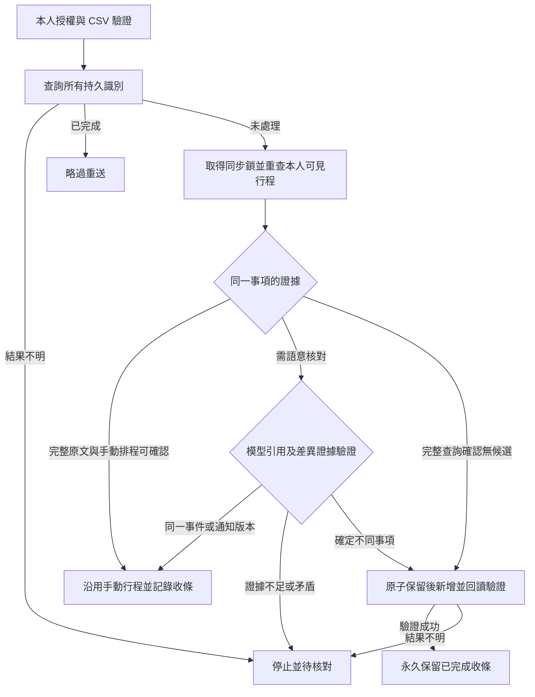

# EIP 公文工作台

入口：`https://ai.changdar-server.mooo.com/eip`。先登入 Open WebUI，
再用**自己的 EIP 帳號**連結。兩套帳號不必同密碼，也不共用密碼。

工作台 HTML 由後端驗證 Open WebUI 登入 Session；未登入或 Session 失效會以 303
導向 `/auth?redirect=...`，登入後回到 `/eip`。有效的 `?csv=<UUID>` 會保留，
不接受外站回跳網址。待核准帳號回傳 403，不顯示帳密表單或造成跳轉迴圈。
API 仍獨立驗證身分並回傳 401／403，不以隱藏頁面代替權限檢查。
使用期間 Session 過期，頁面下次 API 請求也會引導重新登入。

Open WebUI 原生首頁／聊天提示列提供「進入 EIP 公文工作台」連結。
啟動時以固定 banner ID 加入 `ui.banners`，保留其他公告與管理員對該入口的修改，
不修改第三方前端打包檔。若曾關閉提示列，可直接使用上述網址。

## 簡易模式：綁定一次，每小時自動執行

### 受控多角色協作

手動與每小時排程統一呼叫 `integration.process()`；排程以單份 EIP 簽核的附件作為一組，兩者都經由
`multi_agent.process_with_team()`，以固定、有界的直接流程逐組執行。

| 角色 | 可看到與決定的內容 | 不可做的事 |
| --- | --- | --- |
| 工作協調 Agent | 只讀本次使用者指令，產生嚴格 `JobPlan`；選擇輸出及相對提醒，必要時要求釐清 | 不能讀文件、帳密、舊對話，不能授權 EIP 寫入 |
| 公文判讀 Agent | 每個 flow 使用獨立狀態與提示詞；共同閱讀同組附件，決定主公文、說明行號、期限與證據 | 不能改協調計畫、跨 flow 取資料，不能改 Word 正文或決定登入／匯入 |
| 確定性工具 | OCR、逐字證據驗證、原版面輸出、日期計算、CSV 組裝、權限與匯入 journal | 不作無來源的語意推測，不把工具改名冒充 LLM Agent |

`application/multi_agent.py` 依序負責規劃、逐組判讀、工具輸出與結果彙整。
此 EIP 流程是**有界的專業分工**，不是讓主 Agent 任意探索 EIP 或使用任意工具的通用助理。
`company_agent/` 則是另一個五角色工具協作核心（協調、檢索、文件、資料、審核），尚未接管每小時排程。

自動排程沒有特殊指令時，協調使用既有固定 `JobPlan`，不增加 LLM 費用；
有特殊指令時最多一次規劃模型呼叫，每個 flow 最多一次整組文件判讀。
不額外加一個模型重讀文件作「審核」，證據驗證仍由程式執行；失敗不回退到舊 pipeline 或其他模型。
同組附件一起看、不同 flow 隔離；沒有期限不新增 CSV 行程。CSV 判讀失敗仍保留成功的 PDF／Word。

手動工作進度顯示目前 Agent／工具階段，結果的 `orchestration` 提供角色與狀態摘要，
不保存原始模型回覆或把來源全文放進該摘要。子圖不持久化原文 checkpoint，也不繼承主機 LangSmith tracing。
背景排程仍沿用原本持久階段與防重複匯入 journal；重新登入與人工簽核邊界不變。
服務重啟仍可能中斷進行中的轉換；不宣稱可重播任意節點而保證外部操作只做一次。

回歸測試涵蓋父圖／子圖實際執行、上下文隔離、協調釐清、輸出計畫不可被文件覆蓋、
沒有期限、附件缺失、模型失敗不重試、部分輸出保留、不同 flow 隔離及既有匯入去重。

### 相同附件的共用處理

公文 PDF 處理完成後，優先使用結果中的「EIP 行事曆預覽／確認匯入」連結：
`公文 PDF → 既有 CSV → 預覽／確認 → EIP`。此路徑直接使用本人已產生的 CSV，
不重新讀取原始 PDF、不執行 OCR 或 Word 排版，也不重新判讀文件；遇到相似的既有
行程時，仍會進行獨立的行程核對。成功／結果不明的寫入收條會在重啟後繼續防止重送。

若使用者另外從 EIP 選取同一份原始附件，公文 PDF 上傳與 EIP 處理入口也會綁定
同一個 app-owned 內容快取。WebUI 請求及背景公文工作都在入口綁定，核心方法不逐次
傳入 app 或設定。相同內容與相關設定可沿用 Office 轉換、原文擷取、OCR 及 Word
位元組；兩種入口的分組與個人化判讀契約不同，仍各自驗證，不能直接拿整份分析結果
當作另一條流程的成功結果。

相同附件寄給不同人時，各人先通過自己的 EIP 綁定與附件存取檢查、取得實際內容，
再以 SHA-256 及處理設定查詢 PostgreSQL 共用內容快取。檔名、URL、flow ID 或呼叫端
提供的雜湊都不能代替授權與實際內容核對。快取限定同一伺服器的 EIP origin／資料庫
schema 範圍；它不提供跨使用者下載原檔或查詢雜湊的 API。

| 階段 | 共用內容 | 每人仍各自處理 |
|---|---|---|
| Word 輸入轉 PDF | 相同原始位元組的中性 PDF 內容 | 來源檔案 ID、擁有權及下載紀錄 |
| OCR | 同一 PDF 區塊、頁數與 OCR 設定的已驗證辨識結果 | 本人的來源讀取授權 |
| PDF 原文 | 相同 PDF 的完整原生文字或已驗證 OCR 文字與結構行號 | 各入口的文字容量限制與來源驗證 |
| 公司助理唯讀附件 | 相同內容、模式與頁碼的文字區塊 | handle、工作、名稱與工具收條 |
| 可編輯 Word | 同一 PDF 與 renderer／OCR 設定的 DOCX 位元組 | 輸出檔案 ID、名稱、來源 metadata 與交付收條 |
| 長文件分段選證 | 完整來源片段與相同模型設定的選取範圍 | 本人來源授權及證據驗證 |
| 公文內容判讀 | 相同文件版本與判讀契約的分組、欄位、相對期間及內容核對 | 個人收文日期、期限試算、本人指示與提醒篩選 |
| 行事曆同步 | 使用上述共同判讀 | 個人 CSV、遠端行程核對、授權、寫入及防重 journal |

公文付費判讀使用另外的持久化紀錄，成功結果不受下方七天內容快取期限影響。
多人同時處理相同版本與條件時共用一個產生者；每人仍須取得自己有權讀取的實際附件，
不會共用個人行事曆或將他人的寫入成功狀態當成本人的成功。
公司助理的來源內容判讀保留本人計費連線，命中共同結果時不新增模型呼叫與費用；
個人指令規劃、對話及既有行程衝突核對仍獨立執行。完整識別、異常恢復與操作方式見
[一次判讀與多人同步](../examples/official_document_workflow/README.md#一次判讀與多人同步)。

相同內容同時到達時，由 PostgreSQL 的內容鎖協調一個產生者，其他請求等待後讀取
已驗證結果。Word 在進入 spotting OCR 前先協調，因此命中時不再重做 spotting 或
Word 排版。每頁都有原生文字且沒有顯示點陣圖片的 PDF，兩種入口都使用原生文字座標；
沒有原生文字或含點陣圖片的頁面須先 OCR，避免只有原生頁首、掃描正文卻未被讀取。
這類 PDF 使用 spotting；包含 logo 的頁面也採相同保守規則，不猜測圖片內是否有文字。
原生與 OCR 排版分開識別，部分頁與跨來源組頁另保留原始頁序及辨識
上下文，避免沿用不相容的版面資料。
可共用資料以獨立用途、scope、key 與程式版本綁定後加密；讀取會重新驗證
資料契約，損壞或版本不符的內容不沿用。來源或相關設定改變會得到不同 key。

根目錄 `config.local.toml` 的 `[webui]` 可設定：

```toml
EIP_SHARED_CONTENT_CACHE_ENABLED = "true"
EIP_SHARED_CONTENT_CACHE_TTL_SECONDS = "604800"
```

設定在應用建立時讀取，變更後重啟生效。預設保存成功內容七天，TTL 可設 60 秒至
30 天，命中不延長期限。關閉時恢復各自處理；Pipe 的
`document_analysis_cache_enabled=false` 另可停用該次分析與輸出的快取。
程式版本、OCR 端點／生成參數、Office image 或 Word renderer 版本變更會使對應結果
失效；原地替換模型權重時應更新部署識別或停用快取，不依賴同一別名代表內容不變。

本機轉換或 OCR 失敗時，短暫保存失敗標記，避免等待者立即重做同一件失敗工作。
共用的付費分段選證則先持久登記開始狀態；程序中斷、模型結果不明或成功內容未能
提交時，保留 `unknown`，不因 TTL、重啟或下一位使用者到來而自動重送。
明確 HTTP 429 或送出模型前的身份核對拒絕則使用短暫退避，其他人不會因此被永久阻擋。
已收到成功結果的當次請求可繼續使用該結果，不會被快取提交失敗覆蓋。
管理員應先核對模型端紀錄，再決定是否明確解除該筆標記；可按實際 schema 查詢
`shared_content_cache` 的 `state='unknown'`，使用 `scope`／`key` 精確定位，不能用
批次清空或修改到期時間代替核對。

到期清理需明確執行，不會在請求中掃描或刪除。預覽與套用命令：

```bash
ai-gateway exec webui -- python -m examples.shared.runtime.retention --shared-content-cache
ai-gateway exec webui -- python -m examples.shared.runtime.retention --shared-content-cache --apply-shared-content-cleanup --batch-size 100
```

每批只清理到期且未被處理中的成功／本機失敗快取；`unknown`、個人來源、成果及
外部寫入收條不在清理範圍。

共用快取不取代每人的成果紀錄。即使其中一人的輸出失敗或結果不明，也不會把另一人的
檔案視為其成功成果；已完成的 PDF 仍按原部分成功契約保留，行事曆寫入不會因共用
內容而跨帳號合併。

### 綁定與排程範圍

2026-09-05 新增：綁定時勾選「保存加密密碼並啟用每小時自動處理」。
這是每位使用者各自的持續授權，**舊的短期 Session 不會自動升級成保存密碼**。
首次啟用以當時往前 24 小時為固定抓取起點，約 15 秒後排入首次執行，
待處理文件匣（待簽核／待經辦）不限日期、不分已讀／未讀；我的簽核紀錄、通知紀錄、我送出的簽核仍只包含文件匣紀錄時間在起點以後的文件；
之後每小時登入一次。網頁關閉不影響排程，重啟後從持久紀錄接續。
起點不是滾動的 24 小時視窗；停機多日也沿用原起點補查三個歷史文件匣，待處理匣則每輪查詢全部日期。
`scan_origins` 按 WebUI owner／EIP user ID 保存起點，同帳號重新綁定（含解除後再綁）不重設；
換 EIP 身分有獨立起點。進階手動日期篩選不受此限制。
歷史文件匣查詢先按日期縮小範圍，再依文件匣紀錄時間精確過濾邊界；無法解析時間則停止，不猜測。待處理匣 RPC 使用空日期條件，是否納入以本輪完整清單為準，不要求日期欄位完整。分頁重複或達 1000 筆保護上限會明確停止，不默默截斷。
去重沿用 WebUI owner／EIP identity／簽核編號，重啟、移動文件匣及重新綁定不清除已完成紀錄。僅因日期排除的 `outside_scope` 且未下載／產出／匯入過，若本輪仍在待處理匣則重新納入。已完成、需檢查及未知寫入結果不自動重做。每輪處理最多 10 份，剩餘工作留待下一輪；不會自動簽核。

2026-09-07 不限日期改版驗收：EIP 回歸 146 項中 145 項通過、1 項環境依賴測試略過；三組前端測試通過。實際綁定帳號唯讀清單驗證取得 44 份待處理件（33 份早於原起點），其中 2 份已有自動處理完成紀錄；四匣去重共 51 份。驗收未下载附件、呼叫雲端或寫行事曆；保留帳號原有暫停狀態，不自動啟用排程。
`sent` 使用發文時間，不以預定完成日篩選，也不將預定完成日送入公文期限分析。
沒有固定起點的舊版綁定，升級時設定為升級時間前 24 小時並暫停，需確認後重新綁定。
舊版尚未完成的佇列轉為待檢查，既有輸出及匯入去重紀錄不刪除。

自動流程：

1. 確認 WebUI 使用者仍為 user/admin、綁定授權仍有效。
2. 解密憑證登入 EIP，核對實際 EIP user ID 與綁定相符。
3. 分頁查詢自己的 `inbox`、`sign`、`notify`、`sent`，不以已讀／未讀篩選；使用者先開啟閱讀不會漏抓。
   依實際 `wf_receive.htm`，主旨是索引 3、收件時間 7、未讀／粗體旗標 9。
   `0` 是已讀；未知讀取旗標保留為未知，但不影響待處理文件的收錄。
   是否已自動處理只看本系統的持久工作紀錄，不以閱讀或簽核狀態推定。
   每匣最多檢查 1000 筆，超限、分頁重複或任一清單失敗時停止本輪，不把部分掃描當作完成。
   同一 flow ID 跨匣去重，依 inbox、sign、notify、sent 順序保留第一筆合乎日期範圍的紀錄。
   已核對部署網站 `/tw/wf/wf_left.htm`：UI `listFilter('send',0)` 轉為 RPC `curfolder=sent`；不是 `send` 或全公司 `in_progress`。
   `/tw/wf/wf_sendbk.htm` 的索引 7 是發文時間、8 是預定完成日；9 是狀態／逾期旗標，`sent` 的 unread 保持未知。
   待下載工作會更新所在文件匣，Detail 使用該匣而非固定 inbox；不掃描歸檔或全公司文件。
4. **開啟 Detail 前先持久保存待處理紀錄**，避免 EIP 變成已讀後遺失工作。
5. 每輪最多處理 10 份文件，每份最多 10 個 PDF／DOCX／DOC；其餘留在待處理佇列。
   相同 WebUI owner／EIP user ID／flow ID 不重複建立工作。
6. 下載附件；Word 先以隔離 LibreOffice 轉成 PDF，再沿用現有 OCR、雲端來源驗證與 Word 版面工具。
   同一 flow 的所有已選附件共同判讀一次；不同 flow 分開。自動排程每個 flow 一組，手動由伺服器上的附件 handle 分組，不接受用戶偽造分組或來源 ID。
   模型依完整內容判斷唯一主公文／補充附件，回傳已閱讀的來源 ID 清單；關係不明或多份獨立主公文時標示待檢查。
   主公文日期、文號、原始主旨在主公文來源驗證，僅供文件改名。行事曆獨立採用 v2 契約：每項事件各有 LLM 產生的精簡事項名稱、任務、日期／時間、地點及逐欄位來源行號，允許跨附件互補，不限於正式說明欄。
   CSV 說明由模型選擇完整說明／備註及附件補充範圍；程式再合併所有事件欄位引用的原文段落，防止選了備註卻漏掉上方會勘時間。依来源順序逐字保留並標示出處，只排除已記錄的系統版面標記。模型選擇事件與來源，程式核對日期／時間是否與所引用原文一致，不以檔名或發文日期猜測行程。
   頁面／區塊標記保留在各附件 text，整組超限不截斷，任何附件讀取失敗不以剩餘內容冒充完整判讀。無備援模型或自動重試。
   每檔原始 PDF 改名副本／可編輯 DOCX 獨立產生並保留成功輸出；不提供額外 OCR PDF。CSV 說明錯誤不刪除 PDF／Word。
   主公文改名使用驗證資料；附件名稱以該組日期／文號＋附件序號＋原檔名識別（不修改附件正文）。無法確認改名資料則保留來源檔名並顯示未完成改名。
   CSV 合併各組通過驗證的行程，再套用本次使用者提醒指令；未通過驗證的一組不偷偷只輸出部分期限。
   用結構化處理結果核對檔案，不從 LLM 的「成功」字樣推定完成。
7. 文件輸出與行事曆分別驗證；`calendar_ready` 只由後端確認 CSV 已保存、各事件驗證通過且無待釐清提醒後設定。改名或 Word 輸出失敗仍顯示警告，但不阻擋獨立通過驗證的行事曆；未通過的日期、原文、關係或 CSV 不得匯入。
   不需要逐次確認；其授權來自帳號綁定時的自動處理勾選，不是 PDF 中的指令。
8. 結果與下載連結顯示在頁面「自動處理狀態與下載」。

沒有 PDF／Word 附件不轉換 EIP 表單網頁；沒有明確期限不捏造行事曆事件。
`no_pdf` 文件至少一小時後若再次出現在掃描範圍，重新排入附件檢查；等待期間更新文件匣但不延後檢查時間。
只重新檢查附件清單，未補件不呼叫雲端或匯入。原有 no_pdf 紀錄也適用，不重設抓取起點。
已完成、待人工檢查、匯入結果不明的工作，不因移匣或再次出現而重做。
不代為簽核，也不分享全公司或寄信。EIP Detail 可能自行更新已讀狀態，
本程式不呼叫另外的標記已讀 API。已處理的 flow 後來追加附件，目前不自動重做，
可使用進階區手動處理。

「暫停」會撤銷後續自動工作與自動寫入的授權，但已送出的請求可能完成。
保留帳密，因此使用者主動操作的手動查詢／預覽仍可重新登入，不會因此恢復自動排程。
「解除綁定」另外移除儲存的加密憑證及短期 Session；輸出檔與去重紀錄保留。
2026-09-07 已移除「連續三次失敗永久暫停」規則。登入／清單查詢失敗仍保留
啟用，每小時再嘗試，不立即循環重登。使用者主動暫停、解除綁定或 WebUI
權限停用仍立即生效。

2026-10-28 將 EIP 手動選檔、自動排程、共同判讀及行事曆夾檔上限統一為
10 個（原為 5 個），由 `domain.limits.MAX_EIP_ATTACHMENTS` 共用。
已部署正式環境，206 個 Python 測試與兩組前端測試通過；10 個可完整處理、
11 個會明確拒絕。先前僅因舊上限而停止、且沒有下載或匯入副作用的 6 附件
工作已備份後重新排入原本排程；其他待檢查工作不批次重跑。詳見
[10 附件上限部署驗證](eip-ten-attachments-production-validation-2026-10-28.json)。
單件超過 10 個支援附件時，只把該件標為
`needs_review`，保存 `input_issue.code=too_many_attachments`、實際數量及上限，
提示至工作台分批選取；不下載／分析該件、不計入帳號故障，繼續同輪其他文件。
恰好 10 個附件可正常處理，已標待檢查者不會自行無條件重試。其餘連線失效、雲端
錯誤、未預期例外及寫入結果不明仍停止該輪，不放寬既有核對與防重規則。
成功模型回應若未通過必要公文欄位或原文依據驗證，另以
`input_issue.code=document_validation_failed` 保留來源並標待檢查，繼續其他文件；
不產生未驗證的行程，也不自動重送該件。此分類不包含網路、服務、配置或
未預期執行錯誤。88 個自動排程、錯誤分類與記名測試通過（使用隔離 PostgreSQL schema）。

2026-10-28 內容驗證優化：修正 `本（115）年10月16日`、`明（116）年1月1日`
等明示數字民國年被誤判的問題。半形／全形括號及數字僅作格式正規化，仍逐項驗證
同一段原文的年月日；不從系統年份、發文日或文件匣時間推算缺漏日期。

EIP 判讀遇到已識別的格式、欄位、原文行號或日期引用錯誤時，沿用本次完整來源，
最多進行一次模型更正，不重新 OCR；公文欄位、行程驗證及既有的空事件／漏時刻更正
共用同一個更正額度。更正不得省略原有行程。若主公文欄位已驗證，但行程仍未通過，
保留 PDF／Word 下載，該組不產生未驗證的 CSV，不自動匯入；主公文本身未通過則保留來源。
文件關係不明、事件數量超限等不以反覆判讀解除；缺實際送達日時不宣稱已確認期限，
後續已依使用者選擇啟用下列 EIP 相對期限推估規則。
連線、雲端暫時故障／限流及未識別的程式錯誤維持原本停止語意，不納入內容更正。

`GET /api/v1/eip/status` 的各筆 `automatic_results` 新增 `validation_issues`，
只回傳本人紀錄。每項包含 `code`、`reason`、`next_action`、`group_index`、
`event_index`、`field`、`repair_attempted`、`can_auto_repair`；`can_auto_repair`
表示該問題類型支援更正，`repair_attempted=true` 表示本次更正額度已使用，
不是允許前端無限重送。既有 `notice`／`errors` 同樣提供可讀原因與處理方式。
主要代碼為 `document_group_ambiguous`、`document_metadata_unverified`、
`event_date_evidence_mismatch`、`event_time_evidence_mismatch`、
`event_source_reference_invalid`；不把任意模型例外文字存成公開原因。

修正通過 304 項回歸測試，並以實際失敗回應及原始附件重播，確認括號民國年修正後
可直接通過欄位、日期與語意驗證，不需模型重新抽取。正式部署等候工作空閒，未取消
執行中工作；本月有 29 筆停在舊版判讀驗證、尚無輸出及匯入的工作，已另行備份後
排入一次修正後重檢，沿用既存來源與行事曆防重紀錄。
實際受影響的 flow 59533 已由正常排程完成 2026-10-16 行程補同步，四份來源／
輸出檔案及行事曆收據、遠端明細皆通過獨立回讀；詳見
[內容驗證修正與正式驗證紀錄](eip-content-validation-production-validation-2026-10-28.json)。

### 相對期限推估提醒（2026-10-28）

使用者選擇「AI 直接推估處理」後，EIP 每小時處理及 EIP 公文分析可對明確成立的工作，
依原文「文到／收文／送達後 N 日」或「發文後 N 日」產生推估期限提醒。
自動處理會讀取同一 flow 的表單資料，優先使用文號與已驗證主公文一致的 EIP 收文日期；
沒有相符收文日期時，以已驗證主公文的發文日期暫代送達日。手動 EIP 分析若未帶入
表單收文資料，同樣以發文日期推估。文件匣、同步或模型執行時間不作為收文事實。

AI 只選取工作及原文明示的起算條件、天數與計日方式，程式重新驗算日期。
一般日／天及週按曆日，工作日／工作天只先排除週末；明示含當日才計入起算日。
所有這類行程標題均帶 `【期限推估】`，說明列出起算資料、天數、計算方式及假日規則待核對，
不把發文日稱為已確認的送達日。原文沒有時刻時先作全天提醒；已載明的時刻仍須通過原文驗證。
沒有明確天數、起算條件不明、未核定提案、取消或無關事項，不因啟用日期推估而變為有效工作。
保留原有的欄位、來源、語意及既有行事曆核對；未通過者仍待檢查，不放寬寫入防重。

推估紀錄保存在輸出與 CSV 中繼資料的 `date_estimates`／`relative_date_estimates`，
本人 `automatic_results[].date_estimates` 可讀 `anchor_date`、`anchor_source`、
`days`、`day_type`、`include_anchor_day`、`deadline`、`estimated`、
`receipt_date_recorded` 與 `holiday_rules_verified`。這些欄位供顯示推估依據，並非法律期間的確認。

本月 90 筆僅因日期待補而停止、且沒有既有或不明匯入的工作，經備份後排入一次行事曆補處理。
事後核對發現原本的候選預篩過寬，部分發文日期被誤認為可能的相對期間；實際行程仍須通過
獨立的原文天數、起算條件與工作驗證。後續預篩已增加日期邊界檢查，避免再次選入這類日期。
344 個既有 PDF／Word 於判讀前後核對本人權限、完整
來源集合及 SHA-256 後沿用，不重新轉檔；補處理必須實際產生通過驗證的推估行程，
不能藉回傳空事件將舊工作標為完成。CSV 與行事曆仍重新驗證並套用原本的匯入收據保護。
程式通過 339 項測試，並以真實公文驗證「10/1 收文、原文明示五日」可產生 10/6 推估資料。
部署與驗證詳見[相對期限推估驗證紀錄](eip-relative-date-estimates-production-validation-2026-10-28.json)。

### AI 追蹤提醒與部分行程同步（2026-10-28）

經使用者選擇後，指定的 Open WebUI 使用者與 EIP 身分配對可啟用 AI 追蹤提醒。
後端透過 `EIP_TRACKING_REMINDER_ACCOUNTS` 設定精確的 `使用者 ID:EIP 身分` 配對，
未列入的帳號預設不啟用；重新綁定為其他 EIP 身分不會自動繼承設定。
本人狀態 API 的 `automatic.tracking_reminders_enabled` 回傳目前設定。

原文工作已明確成立，但只寫「儘速」或沒有明定日期時，AI 可依工作內容建議收文或
發文後建議追蹤日期，間隔依具體事項判斷。系統驗證來源、起算資料及建議天數，行事曆標題顯示
`【追蹤提醒】`，說明列出基準、建議理由，並標示「非公文明定期限」。已有明定日期或
相對期間的工作走既有驗證；未核定、取消或關係不明的事項仍須核對。
`automatic_results[].tracking_reminders` 提供 `anchor_date`、`anchor_source`、
`days_after_anchor`、`reminder_date`、`reason` 與 `receipt_date_recorded`，供前端顯示依據。

#### 行事曆必要性篩選（2026-10-28）

行事曆僅收錄帳號本人或其工作確實需要安排、參與或追蹤的事項。一般通知、備查、知悉、
轉知、背景及已完成事項不因有公文日期而新增；其他單位的時程須有本人需要追蹤的依據。
LLM 依整份公文與附件判斷具體待辦、會議、會勘、行程、稽查、期限及工程工作是否需要
本人安排、參與或追蹤，並由獨立語意核對重新檢查必要性與來源。沒有明定日期時，確有
追蹤必要者可建議 AI 推估提醒，不以「儘速」等特定字詞當作唯一條件；提醒須標示為
推估而非公文明定期限。純通知與沒有追蹤必要的事項不建立行程。既有行程需另行核對，
不因新規則自動刪除。
候選事件的類型與出現的時刻不會被程式直接改判為目前行程；時間索引僅提供模型複核
的線索。追蹤間隔由模型依來源及事項判斷，不設固定業務天數上限；日期計算仍須有效。
帳號啟用配對為部署設定與授權範圍，不是以特定帳號判斷公文內容。
啟用 AI 追蹤提醒的每小時處理也可對已通過核對的基準行程提出必要的事前準備建議；
獨立核對須確認工作與原文的關聯及必要性，未通過時不新增該提醒，原基準行程仍保留。
建議的提前天數、時段及做法清楚標示為 AI 建議，不視為公文明定期限；時程由模型依
上下文判斷，不限定固定天數。來源與目前日期須允許，已有過去日期不自動挪到其他日期。
行事曆新增仍由既有 EIP 防重、授權及回讀機制處理；是否推播由 EIP 原有設定決定。

若同一文件有已獨立驗證的行程和其他待確認事項，可同步已驗證的 CSV，並將工作維持
`needs_review`；原有 `calendar_pending`、錯誤與匯入結果會保留。文件輸出錯誤、未完成
語意核對、不明寫入或未授權來源仍不會自動匯入。每筆行程繼續使用既有防重與回讀機制。
正式部署通過 340 項 Python 測試，並用實際公文進行不寫入行事曆的判讀驗證；
後續增加核對者必須引用同一工作來源的檢查，相關 133 項測試通過。
既有 `CalendarGraphTests` 已更新為檢查目前的一次內容更正、來源驗證及待核對政策；
含這些測試的完整本次回歸共 424 項通過。
全天跨日資料會展開成逐日行程，每日保留完整區間與來源，並核對 EIP 預覽及實際回讀；
既有整段匯入收據會阻止自動重送。單一區間超過 100 天時保留待核對，不會只建立首日
後標示成功。附件在寫入前也會驗證單日格式，避免留下未執行上傳卻結果不明的紀錄。
跨日修正後完整回歸共 445 項通過。
本次指定帳號的重檢進度與事後回讀紀錄見
[帳號重檢紀錄](eip-account-tracking-recheck-production-validation-2026-10-28.json)。

同日已使用既存且通過驗證的 CSV，完成文號 1155022101（flow 59905）的指定
補同步：新增 2026-10-22 14:00 會勘及一份公文 PDF 附件，EIP 回讀與防重收據
皆通過；該帳號沒有相符的參與專案，本次以私人行程建立。未重做此件 PDF 判讀。
同日上午補同步驗收時，7 個啟用帳號皆經登入、完整文件掃描及正式背景排程驗證，
當時可執行佇列與執行中工作皆為零；內容或解析問題仍保留待人工確認，並未改為成功。
後續本月批次重檢仍在背景執行，進度見[本月重檢紀錄](eip-october-recheck-production-validation-2026-10-28.json)。
本次範圍為 7 個已啟用帳號、10/1–10/28 共 579 筆既存工作；253 筆需補處理者沿用
正式排程執行。雲端暫時失敗後，後續正常排程若已推進至其他文件的內容驗證，批次可恢復；
亦可於冷卻五分鐘、同一公文服務金鑰及模型已有新的有效回應後，提前執行下一輪恢復探測；
限流或授權錯誤不套用此捷徑。
失敗文件本身不反覆重送。例外只記錄程式模組、函式及行號，不保存任意例外文字或公文內容。
長附件若必須保留的原文已超過整合容量，或分段讀取後證據仍超限，記錄
`source_evidence_capacity_exceeded`；前者在付費分段模型呼叫前即停止。
分段結果不完整或來源範圍無效則記錄 `source_reading_unverified`，保留來源、待核對，
其他文件繼續處理。這兩種情況不刪減原文來強制成功，也不自動重試模型。
成功且產生費用的 AI 核對與後續排程呼叫均保留操作人且由服務負擔；本次另查到
少數限流失敗紀錄缺少操作人（皆為零 token、零費用），保留未歸戶，不依時間猜配使用者。
實際筆數及費用歸戶檢查列於本月重檢紀錄。
29 項公開 HTTPS／SSO
驗證通過，詳見[補同步及正式驗證紀錄](eip-hourly-recovery-production-validation-2026-10-28.json)。
舊版已自動暫停的帳號須先驗證本人權限與已存憑證，再以世代及精確暫停原因比對恢復；
不批次重設、不恢復手動暫停、不變更抓取起點／工作／去重紀錄。

本次回歸：EIP 162 項（161 通過、1 略過），公司助理 293 項（284 通過、9 略過），
三組前端測試及部署後 admin／user 授權與頁面 smoke 通過。真實 EIP 保存憑證登入及
四匣查詢成功（51 筆去重文件）。恢復舊失敗暫停只更新帳號啟用狀態與下輪時間；
既有待檢查公文與已匯入紀錄不重設，未以重跑付費分析作為排程驗收。

### 每小時排程的 Session 過期恢復

長附件：單份 PDF 預設最多 30 頁、一組合計仍最多 30 頁；`max_ocr_pages`
改為單次 OCR 請求上限，`ocr_chunk_pages` 預設 3 頁。Layout 與 spotting 均循序
分批，逐批驗證頁數／頁序，合併為原始全文件頁碼後才共同分析。缺頁不截斷、
不送部分文字冒充完整判讀；Word 保留原始全頁數。來源與下載 PDF 不拆改，
暫存分頁在成功／失敗後清除，未新增 fallback 或平行 GPU 請求。
附件組以 `lines` 字串陣列傳輸，陣列索引＋1 為引用行號，不再對每行重複
`line`／`text` JSON 欄名。原文總量仍受 80,000 字元上限約束；JSON 跳脫與
包裝另有最多兩倍原文預算加 4,096 字元的傳輸上限，未刪減表格或附件內容。
無期限（模型明確回傳合法的 `events: []`）時不需要產生 CSV，故不驗證未使用的
CSV 說明欄位；主公文欄位與整組來源關係仍須驗證。需要行程時，說明及期限
原文驗證完全保留，缺漏或格式錯誤不冒充空期限。

2026-09-07 長附件實測：所提預力混凝土試驗報告案（1 頁主公文＋25 頁附件）。
首輪發現逐行 JSON 欄名放大輸入；修正後全來源約 51,600 字元進入共同判讀。
另修正無期限仍先驗證 CSV 說明造成假性 partial 的問題。最終來源與欄位驗證
通過、events 為空；原工作 done，當時建立 6 個 PDF／可編輯 Word／可搜尋 PDF。
自 v3.10.1 起，PDF 只提供改名的原始 PDF；工作台隱藏歷史 OCR PDF
連結但不刪除檔案／處理紀錄。新工作不產生 OCR PDF，保留內部 OCR、
可編輯 Word 與有明確事件時的 CSV／自動匯入。已完成公文不會因此重跑。

### 跨頁說明驗證（v3.10.2）

後續 v3.11 的獨立事件契約與案例驗收：

- 事項名稱由 LLM 摘要為「專案簡稱｜具體任務」，不再直接截斷公文長主旨。每事件可不同；名稱不得回寫原始 PDF／Word。
- 日期及任務可以來自會勘欄位、表格、備註或相關附件。歷史紀錄、取消事件不新增；矛盾或無日期的候選事件待確認。沒有事件就不產 CSV／匯入。
- 實際 `CM_Import` 會將 `+` 轉空白、百分比序列解碼，故僅上傳傳輸層保護 `%` 與 `+`；工程里程 `0K+000` 不可變成 `0K 000`。下載檔不变，匯入前後仍逐字核對。舊寫入雜湊別名繼續阻擋重送。
- 指定會勘案共同閱讀三附件，保留六個既有 PDF／Word 雜湊不變，補 CSV，去重後新增私人行程 2026/9/8 10:00–11:00；11:00 為已註明的60分鐘預留，非公文事實。詳細頁原文與里程加號已讀回核對。
- 稽核改善案只更新既有2026/9/4整日行程的名稱，未新增事件。整日編輯須依官方 `new_event.js` 省略時間參數；第一次伺服器失敗後先讀回確認未改，再修正參數。完成後以唯讀核對原文、自訂欄位及整日日期；EIP 對隱藏時鐘預設值和文字 escape 編碼的正規化不算內容改動。不明寫入不盲目重送。
- 回歸測試：公文71通過；EIP190項（189通過、1環境略過）；另兩組前端測試通過。

文字來源建立時記錄程式插入的頁面／OCR 區塊標記行號，不依文件文字的
標籤外觀猜測來源。LLM 可選取跨頁／區塊的完整說明範圍；CSV 排除這些
已記錄標記，逐段驗證其餘原文。原文中的相似標籤不刪除、必要時待檢查。
空白／只有標記、行號越界、重疊、亂序、缺乏證據及長度超限仍阻擋。
這不改變 Word／PDF，也不放寬日期或任務來源驗證。
送模型的 `lines` 使用精簡 `[行號, 原文字串]`，模型不必自行計算陣列位置；
提示詞要求逐段核對說明，包含末段要求。工作台亦顯示具體 CSV／輸出錯誤。

舊失敗工作不自動重送。經指定修復時，核對既有檔案權限、來源及原始 PDF
位元組，保留 PDF／Word，只重新共同判讀必要來源、補 CSV。匯入沿用
私人行事曆預覽核對、持久去重與寫入後詳情驗證；不明結果不得重送。
Word sections 分別 1、25，文字分別 483、17,620 字元；輸出 PDF 頁數與原件相同。
後續語意驗收重用已驗證輸出，不重做 Word、不新增行事曆。前兩次部分輸出保留
於加密工作紀錄供追查，來源檔案不變。回歸：公文 71、EIP 164（1 略過）、公司
助理 293（9 略過）；未聲稱僅憑頁數／XML 文字核對即可取代人工排版與 OCR 校對。

每輪開始原本就會使用已保存的加密憑證建立新 EIP Session，不依賴瀏覽器保持登入。
2026-09-06 補上 `automatic_session.py`，處理長時間轉換／雲端分析後的執行途中過期：

- 僅在收到明確 `EIPSessionExpired`（401、同站登入頁轉址或已辨識登入表單）時重登；
  一般網路錯誤、403、500、格式或權限錯誤不推測為過期，也不重試登入。
- 查詢文件匣、附件清單、附件下載、CSV staging／預覽可在重登後重試該操作一次。
  每個帳號每輪最多額外重登一次；不重新跑 OCR、雲端分析或整批工作。
  多匣查詢若中途過期，安全重取整個清單快照，完整取得後才持久化發現紀錄。
- 每次登入重新讀取該 owner 的保存憑證，前後核對綁定 generation、啟用狀態、
  WebUI user/admin 權限及 EIP identity；解除、暫停或換綁定時不復活舊連線。
  明文密碼只供登入，使用後移出暫存字典；不傳給模型或輸出至狀態。
- 行事曆 `commit` **不套用重登重送**。已送出的請求即使回報登入失效，也保留 journal
  的 unknown 狀態、停止本輪並標為待檢查，需人工核對。此前成功事件不會重複新增。
- 暫時網路錯誤（含 HTTP 408／429／500／502／503／504）或安全讀取再次過期時，
  只把附件查詢／下載或 CSV staging 放回讀取前檢查點，最早一小時後重試。
  已保存附件以 URL＋檔名的雜湊對應來源 ID 重用，已完成的雲端分析不重跑。
  權限／格式錯誤及來源存檔、付費分析、行事曆寫入結果不明仍待人工檢查；
  不把一般例外當成可重試。其他未開始工作留待下輪，不改動固定抓取起點或去重紀錄。
- 新失敗紀錄保存階段、例外類型與時間，不保存上游回應、密碼或 traceback locals。
  舊版只留下通用錯誤訊息的工作無法反推具體例外，因此不擅自重跑。
- 成功恢復會在本輪摘要標示「重新登入一次」。密碼已變更時請在綁定設定更新，
  此網站使用 Session／cookie 登入流程，並非以假定存在的 OAuth refresh token 刷新。

Open WebUI 的瀏覽器登入與 EIP Session 是兩回事：前者過期仍導向本人登入，
不能用保存的 EIP 密碼替代 Open WebUI 驗證；已啟用的背景排程不依賴網頁登入是否過期。
未保存 EIP 密碼的短期手動登入，過期後仍需使用者重新輸入帳密。

測試以模擬 EIP、OCR、雲端及行事曆執行，不使用真實憑證或新增真實行程：
`python -m unittest tests.test_eip_automation tests.test_eip_sessions -q`。
修改排程 Python 程式後需重啟 Open WebUI 才會生效；重啟前先確認沒有進行中的工作。

### 持久狀態與加密

- `$DATA_DIR/eip_connector/eip_automation.sqlite3` 保存帳號排程及文件工作狀態。
  帳號密碼、文件主旨、處理结果與檔案清單以 Fernet 認證加密；密文綁定 WebUI owner。
- 金鑰獨立位於 `~/.local/state/ai-gateway/secrets/eip-automation.key`（0600），
  可用 `EIP_AUTOMATION_KEY_FILE` 指定；不放 Git、不和資料庫放同一目錄。
- 金鑰遺失時不自行重新產生以覆蓋既有資料。備份資料庫時應另行安全保存金鑰。
  伺服器管理員仍有解密權限，這不是對伺服器管理員的端對端加密。
- 密碼不傳給 LLM、不回傳 API、不寫入日誌；EIP HTTP 的傳輸風險仍存在。
- `discovered → downloaded → converted → done` 各階段持久化。
  下載／轉換／寫入中崩潰會標成 `needs_review`，不盲目重複花費或重送。
  不明行事曆寫入另由共用 journal 阻擋，包括跨重啟及跨手動／自動匯入。
- 服務單 worker；每小時排程不重疊，漏掉的時鐘週期合併處理，不補跑每一次 tick。
  GPU 忙碌或文件較多時，實際執行可能晚於排程時間。
- 網頁顯示最近 20 筆自動處理紀錄；資料庫保留完整去重狀態，產出檔仍依 WebUI 保存政策。

## 使用方式

以下為進階手動模式；未勾選自動處理時，密碼只用於本次登入，不保存。

1. 連結 EIP 帳號。
2. 選日期、待處理／我的簽核／通知紀錄／我送出的簽核，開啟文件的 PDF／Word 附件列表。
3. 勾選 1–10 份 PDF／DOCX／DOC、輸入本次工作指令，送出背景工作。
4. 工作台回傳現有公文 Pipe 的輸出：分別下載 PDF／DOCX，以及合併 CSV。
5. 點 CSV 的「預覽匯入」，核對帳號、日期、全部欄位，再按確認新增。
   原 Open WebUI 聊天室的公文輸出也新增 `/eip?csv=<file_id>` 入口。

沒有支援附件的 EIP 簽核表單，會顯示沒有 PDF／Word，不會擅自用網頁 HTML 冒充公文。
查看附件可能由 EIP 記錄為已讀；程式不簽核、抽單、刪除公文、寄信或分享给其他人。

工作指令仍沿用受控 planner：輸出選擇、根據已驗證期限前後加提醒、
要求匯入預覽。它不取得帳密／Cookie，也不能任意選 EIP URL、指定其他擁有人、
自行啟用自動匯入或改寫公文事實。模糊的手動指令仍可能要求釐清；工作台需重新送出明確指令。
這不是無限制自主 Agent；定時工作的權限來自帳號設定，不來自模型或附件。

### Word 附件輸入（2026-09-06）

EIP 手動與自動流程支援 `.pdf`、`.docx`、`.doc`（含以 `.doc` 命名的 RTF）。
先驗證副檔名與內容，再把 Word 轉成 PDF；不以改副檔名冒充轉檔。
此變更針對 EIP 附件入口，未擴充原聊天 Pipe 的直接上傳格式。
Word 原始附件仍在 EIP，WebUI 保存供處理的轉換 PDF，輸出的 DOCX 沿用可編輯 OCR 版面重建；
不保證保留原 Word 樣式、追蹤修訂或特殊字型，請校對轉換成果。

部署依賴（明確建置，執行時禁止自動拉取映像）：

```sh
docker build --target eip-office -t ai-gateway/eip-office:1 .
TEST_EIP_OFFICE=1 /home/changdar/.conda/envs/webui_env/bin/python -m unittest discover -s tests -p 'test_eip_office_input.py'
```

每份 Word 使用獨立容器及暫存目錄：無網路、唯讀根檔案系統、非 root、移除 capabilities、
禁止取得新權限，限制 1 GiB RAM／2 CPU／128 processes／120 秒，停用巨集及 active content。
只掛載本次附件與暫存輸出，不掛載帳密、其他公文或 Docker socket。
轉檔失敗／逾時就停止，不回退到主機 LibreOffice 或改用其他模型。
輸入及轉換 PDF 上限各 30 MiB；DOCX 解壓總量限制 100 MiB，拒收加密 ZIP、非 Word ZIP、VBA 封裝。

指定實測：簽核編號 `2609020005`（flow `59105`）的 `.doc` 主公文及兩份 PDF 均可下載驗證，
另以合成 DOCX 實測中文與英文文字轉換。主公文完整處理前兩次因雲端說明來源驗證失敗而停止，
第三次指定測試成功輸出 PDF／可編輯 DOCX；沒有公文期限，因此無 CSV，也未寫入行事曆。
沒有放寬驗證或加入自動重試。測試不改變正式排程起點或自動處理去重狀態。
附件中的報價單、照片不一定是獨立公文；需要共同參照時，請同時勾選同一簽核下的主公文與補充附件。不要求補充附件各有發文日期、文號。

手動結果現在由結構化 `status/files/errors` 回傳；`done` 表示完成，`partial` 表示已保留成功輸出但仍有未完成項目，`error` 表示沒有成功輸出且處理失敗。下載連結直接來自擁有者檔案清單，不再從回覆文字猜測成功。自動排程僅在整組完整時匯入，部分完成仍保留檔案供人工檢查。
此分組模式目前僅適用 EIP 工作台／排程；一般 Open WebUI 直接上傳的多 PDF 仍維持原本各自獨立的處理模式。

## Session、權限與保存

- 手動模式的 EIP Session 僅在單一服務程序記憶體，最多 2 小時／64 位使用者。
  啟用自動模式者另外保存加密憑證，每輪使用新的短期 Session，結束即關閉本機連線。
- 已保存憑證者，手動查詢、附件下載、CSV 預覽在 Session 過期／服務重啟後按需重新登入。
  狀態輪詢不會登入 EIP；另提供 CSRF 保護的 `POST /api/v1/eip/session/restore` 手動重新連線。
  這是帳密重登，不是宣稱 EIP 支援 refresh token。WebUI Session 過期仍須正常登入 WebUI。
- EIP 請求失敗直接傳遞例外，包括 HTTP 401、登入重新導向及已知登入表單。
  不在失敗的請求內重新登入或重試；下一次明確的手動請求可以重新建立 Session。
  `commit` 永遠不走重試；未知寫入沿用 journal 鎖住。若重新建立的 Session 不再有原預覽，
  必須重新預覽確認，不能拿新 Session 自動執行舊確認。
- 同使用者的綁定、解除、手動登入及操作以固定數量鎖序列化，並核對保存世代和 EIP 身分。
  登入失敗會關閉連線並直接傳遞例外；已移除恢復失敗的冷卻狀態。沒有保存的帳密不會從聊天紀錄猜取。
  恢復連線不呼叫 `bind()`、不重設固定抓取起點、也不變動排程狀態。
- 解除連結清除本服務的 Session、加密憑證與待確認預覽；不呼叫其他 EIP 瀏覽器的登出 API。
  EIP 自身若限制同帳號 Session，定時登入仍可能影響其他登入，須依其伺服器政策觀察。
- WebUI verified-user 認證；所有文件 handle、工作、CSV、確認 token 按 WebUI user ID 隔離。
- 跨帳號不可取檔／確認。文件 handle 由伺服器產生，下載前重新確認附件仍屬該文件。
- 輸入網址不能指定遠端下載地址；只接受固定 EIP origin、`/fo/`、`/fo1/` PDF。
  不跟隨重新導向；附件最多 30 MiB、RPC 最多 4 MiB、CSV 最多 1 MiB／100 列。
- 最多 64 份工作結果暫留記憶體 24 小時，一個使用者最多一件執行中工作，
  工作台的 GPU 工作逐一執行。原聊天室工作仍走既有 Pipe 的資源限制。
- 下載來源與產出檔存入 Open WebUI 私人檔案儲存，遵循其保存／刪除策略，
  **不會因 Session 過期被刪除**。工作結果記憶體到期後可從已保存的連結存取。
- 確認 token 綁定帳號連結世代，十分鐘有效，登出／換帳號不能沿用。
- `$DATA_DIR/eip_connector/eip_writes.sqlite3` 只保存事件雜湊、結果狀態、時間與已核對的 EIP 行程 ID，
  不保存公文全文、EIP 密碼、Session 或明文行事曆內容。檔案權限 0600。

## EIP 匯入的實測限制

2026-09-05 依實際 Netask 前端 JavaScript 確認：

- 登入：`Office3Login` → `/tw/findex.php`，Session 由 `u_str` 表示。
- 文件：`List / ap_name=wf`；附件 `Detail / ap_name=wf`。
- 解析：`Common / ap_name=CM_Import`，multipart `importfile`、`encoding=UTF-8`。
- 寫入：`Update / ap_name=cm / subitem=import`；只有確認路由或已啟用的定時工作能呼叫。
- 內部字串編碼是 JavaScript `escape()`（`%uXXXX`），不是一般 URL UTF-8 編碼。
- CSV 中文翻譯列不送到 EIP parser；parser 回傳的尾端空白列忽略。
- parser 忽略 24hr 欄。傳輸前把明確的 24hr 時間或產製端 `HH:MM:SS` 顯示欄轉成等值上午／下午欄；秒數必須為零。兩欄衝突仍停止。
- 2026-09-08 實测 `cm_lang_tw.js` 的 `imptErrType0` 是「匯入檔案主旨超過600字元」。
  提示文字與實際限制不同：只預覽不寫入的邊界測試確認 ASCII 200 通過／201 拒絕、
  中文 66 通過／67 拒絕，因此按 UTF-8 200 bytes 限制處理。本案例 77 字、209 bytes 被拒絕。
  匯入適配器只縮短行事曆顯示標題並加 `…`，完整主旨附在說明前且明示限制；
  原 CSV／PDF／Word 不改。預覽、去重、EIP 解析與詳細資料核對都使用同一份適配結果。
- 每小時已授權自動匯入時，若具有效開始日期／時間、非全天，且結束日期與兩個結束時間欄全部空白，預設預留 60 分鐘。`EIP_CALENDAR_DEFAULT_DURATION_MINUTES` 可設為 60 或 120，其他設定拒絕。說明追加「原文未載明結束時間；系統預留 … 分鐘，非公文載明的結束時間，可依實際安排調整。」僅改匯入資料，不改來源 CSV、PDF／Word；來源已有結束時間不覆蓋。缺開始日期／時間、部分結束資料缺漏或其他矛盾仍停止。手動 CSV 預覽仍要求完整起訖，未默默套用此規則。跨午夜的預留時間會換日；跨日 EIP 實際儲存結果仍須通過讀回核對，不能只憑本機日期運算宣稱匯入成功。
- 2026-09-07 驗收：EIP 測試 149 項中 148 通過、1 項環境依賴略過，三組前端測試通過。對截圖中 CSV `cb1026df-7f76-4f51-be5d-1219bf5f7814` 先做真實 EIP 解析核對，再補匯入一筆 2026/09/18 09:50 的私人時間點提醒；共用 journal 記為成功，原自動工作由 needs_review 改為 done，行事曆讀回符合事件恰為一筆。未重新下載或呼叫雲端，來源檔案未改動。其他待檢查工作未重設或重送。
- 核對 EIP 解析後的主旨、日期、時間、說明、全天、優先、分類與自訂欄位；
  不符則停止。來源 CSV 不被修改。
- `Work Hour`、`Report Status`、`Completed` 未被目前匯入 parser 讀取；
  預覽明示這些欄位不會寫入，仍保留於下載 CSV。
- 自訂欄位含逗號或換行時，舊前端的 `join(',')` 匯入協定無法安全表示，
  因此拒絕，避免猜測未驗證的 escaping 規則。
- 匯入一律**本人私人行程**，不依 `Name` 欄切換擁有人，不分享全公司、不寄信。
  CSV 的 Private 值仍原樣保留，但匯入預覽明示 EIP 目標改為私人。

### 2026-09-07 詳細頁修正

上述早期時間點匯入只核對清單，未充分驗證瀏覽器詳細頁。實際 Chrome 重現：
匯入列尾端的 LF 被 EIP 存進分享欄位，Detail RPC 將裸換行放入 JavaScript 字串，
造成 `Invalid or unexpected token`。已移除寫入列尾端換行（維持 32 欄），
新匯入必須讀回唯一的本人行程並以嚴格 JSON 解析詳細資料，核對日期、時間、
主旨、說明與私人設定；僅收到 Update 成功不再算完成。

新版與舊版含 LF 的事件雜湊以同一交易保留，舊成功／未知紀錄仍防止重送。
詳細頁核對失敗保留 unknown，停止批次，不能自動再新增。已驗證的行程 ID
寫入 journal receipt，方便後續定位。既有資料修復只允許明確指定的本人私人、
非重複、無附件／回報的行程；先保存加密舊值及指紋、更新前重新核對，
使用 edit_event 保留原 ID，不走新增、不寄信、不擴大分享。

本次驗收：EIP 156 項測試（155 通過、1 項環境依賴略過），公司助理 293 項
（284 通過、9 項選用整合略過），三組前端測試通過。截圖中的原行程已更新為
2026/09/18 09:50–10:50；唯讀 Chrome 驗證詳細頁顯示主旨、說明、預留時間註記，
無 JavaScript 錯誤。原 ID 不變、未新增重複行程、未寄通知；自訂欄位經核對語意相同
（import 回傳原文、edit 回傳 escape 編碼）。寫入後首次原始位元組核對停在待檢查，
經唯讀重新核對後才結案，未重送。原 CSV、PDF、Word 未修改，未呼叫付費雲端模型。

## 重複與不明結果

v3.14.7 的自動同步與本站手動匯入共用同一套新增前核對。它讀取目前 EIP 帳號看得到的
本人與共享行程，逐筆核對清單與明細的擁有人、日期及識別碼；不使用其他同事的帳密，
也不讀取目前帳號看不到的私人行程。確認共享原件為同一事件後，保存略過收據，
不另外建立本人複本，也不修改原件的內容、專案、分享、提醒或附件。

核對分成「事件身分」與「通知版本」。文號、發文日期或原文引用日期不同，不再直接
排除 AI 比較。同一工程、同一月份／次數或可識別當事人的具體工作，可以是同一事件的
不同通知；不同月份、次數、工程、責任人或工作階段仍需各自保留。
放寬文號或時間差異時，AI 必須分別逐字引用雙方的具體工作、工程名稱及事件身分證據，
程式再驗證引文、排程及固定身分限制。只有相似標題、泛稱或缺漏證據，不足以自動認領。

例如雙方行事曆都排在 10/21 10:00，工程、月份與第9次會議身分一致，舊說明仍引用
10/20 通知時，可沿用目前共享原件而不新增。若目前行事曆實際排程也不同，但有充分
新舊通知證據確認是同一事件，則略過重建並顯示排程版本提醒；原行程時間不會自動覆寫。
無法確認事件身分或有未解矛盾時，停止新增，保留資料供核對。

專用設定 `calendar_reconciliation_model` 已設為公司核准的 `gemini-3.8-flash`；
公文判讀模型及其他設定保留。模型使用必要欄位完整的 JSON schema，並經本機驗證；
不自動改用其他模型。模型只收到本次可見候選的文字快照，不收到帳密、Cookie 或可執行工具，
請求使用 `store:false`。成功結果的 `calendar_reconciliation` 與 `notice` 記錄共享沿用、
判斷理由及排程版本提醒。確認／寫入前重新讀取候選；只有完全相同快照才沿用本次判斷。

搜尋以待新增行程日期為中心，包含同日可見行程及前後各15日的標題相關候選，
含當日共31個日曆日，並包含第15天邊界。若完整來源明確載明「原訂／原定年月日」及
改期／延期等文字，另查原訂當日，單一日期批次最多兩個原訂日、跨度最多366日。
舊日候選不以標題相似度略過，仍須通過工程、具體工作及同一期次三項引用證據，
才可認作排程版本；只找到舊日期不代表可直接沿用。原訂日期缺少年份、無效、過多或
超過範圍時停止新增，交由人工核對。週期行程採清單的實際發生日，其他期次獨立。
每次清單上限500筆、每次核對上限100筆明細；AI 每事件上限32個候選、整批128個配對。
每次請求最多120,000個 JSON 字元、四筆事件（有版本或時段差異時兩筆），整批最多16次請求，
每次輸出上限4,000 tokens。讀取、模型、引用或完整性驗證失敗時停止，不截斷候選後猜測不存在。

EIP user ID 與實際匯入資料的持久 journal 仍在遠端寫入前原子保留；已完成的 `done`
不重送，逾時、斷線或不明結果保留 `unknown`，須先核對，不應直接刪除收據來重試。
另將完整來源雜湊、工程、具體工作、日期時段、明確地點／責任人與文號等欄位組成
持久識別，排除模型補充說明及已知工程前綴引號差異；重新產生 CSV、重啟或快取到期
仍能沿用收條。此識別仍限定實際 EIP user ID，不跨帳號套用私人寫入紀錄。
每次預覽及鎖內寫入前重查所有新舊識別；任何一筆 `unknown` 都優先於 `done`，
過期預覽不能繞過另一個程序的保留紀錄。已完成收條不會因遠端行程刪除而自動補建。
資料仍保存在既有 PostgreSQL EIP schema 的 `writes`、`event_receipts` 及來源清冊，
不將公文全文存入識別欄位。人工優先清理另使用 schema 12 的來源與加密備份表（見下）。
資料庫同步鎖涵蓋受管理流程的核對、建立及自動專案分享，避免兩個帳號同時各建立一份。
已處理的來源、輸出及收據不因升級重跑；缺少可靠建立來源的歷史重複行程不會被猜測刪除。

既有手動行程若引用相同完整原文，且工程、具體工作及同一天可確認，優先沿用；
明確地點／責任人不得矛盾。確認同一事件後，即使雙方明確時段不同，也以單一人工排程為準。
這項確定性核對不呼叫模型，也適用未啟用行程核對模型的入口。
手動行程只會被沿用，不改時間、分享、專案或附件；單憑相同工程、日期或相似標題不足以沿用。
多筆符合來源的手動行程若彼此時間或責任人矛盾，且新資料無法唯一識別，維持待人工核對，
不任選一筆。結果訊息分開記錄直接原文核對與實際模型核對。

### 人工上傳後清理受管 AI 複本（2026-11-14 已部署）

每次本站建立 AI 行程，先保存建立意圖，再送至 EIP；成功回讀後登記實際事件 ID、
原匯入收條及加密快照。沿用既有行程不會取得「本站建立」身分。本站後續驗證完成的
專案分享與附件更新會推進快照；若原快照已有其他人工修改，不會把它覆蓋成可自動刪除的基準。

每小時自動處理在讀取新公文前核對最多20筆到期的受管行程；沒有新公文仍會執行。
確認匯入時也核對該份收條對應的受管行程。預覽只讀取，不刪除。單筆未找到人工候選時，
下一小時再查；超出單輪上限的紀錄依序輪查，不把未查完當作沒有重複。

人工上傳可以保留 `[AI產生]` 標記，因此不以標題判斷可刪除對象。
可刪除的 AI 必須有本站送出前意圖、成功建立及尚未被人工更動的快照紀錄。
人工／外部候選必須是本人當下可見、完整原文、工程、具體工作及同一天可確認的事件，
且不在本站受管建立清冊中。若仍帶 AI 標記，另要求 EIP 建立時間晚於受管 AI，且候選
實際建立者沒有結果不明的本站建立意圖，才視為後續原生人工上傳的候選。
這依賴升級後所有本站 AI 寫入都經來源記錄，以及 EIP 事件 ID 的建立時間契約；
若另有未登記的外部自動寫入來源，不能單憑「外部新增」證明由人操作，須先人工核對來源。
較舊、缺少來源的 AI 標記行程仍待核對，不猜測人工身分；跨日期、不同期次或多筆人工時間
互相矛盾，也不在這條確定性刪除規則中。人工作業先於系統建立且來源可確認時，匯入階段即沿用。

刪除僅用目前帳號處理自己建立的 AI；不登入其他人的帳號、不刪人工行程，也不改人工
時間、附件、專案或分享。若 AI 已分享給多人，人工行程必須明確涵蓋原收件人，否則保留待核對。
週期系列、工作／回報紀錄、快照漂移或任何未解來源收條都會阻止刪除。

先備份兩筆行程快照及 AI 行程全部附件，再重新讀取確認未變更，原子保留單次刪除收條，
最後才送出刪除並驗證 AI 已消失、人工仍存在且內容不變。附件每份最多50 MB、總量最多100 MB，
無法完整下載或備份時不刪除。刪除逾時、斷線或回讀不符保留 `deleting`／`unknown`，
不自動重送；下輪顯示待核對。原成功匯入收條永久保留，舊 CSV 重跑不會補建被清理的 AI。

資料庫新增 `calendar_creation_intents`（送出前意圖）及 `calendar_managed_events`（來源、
狀態、加密快照與加密附件備份）。備份使用既有獨立0600金鑰，沒有 TTL；不在公開下載或模型輸入中。
原文與附件只以密文保存，操作收條不記錄帳密或全文；金鑰遺失不會重建空白歷史。
2026-11-14 已完成 EIP PostgreSQL、私人資料與金鑰最終備份，停妥舊寫入程序後升級 schema 12，
並切換正式服務。既有資料表內容、設定、NAS 綁定及金鑰均經核對保留；升級與部署驗證未刪除行程。
部署機366項回歸測試、升級／退回及正式站驗證通過，排程、清理與輸出背景程序正常。
部署收據與檢查結果見[部署驗證紀錄](calendar-workflow-deployment-2026-11-14.json)。

驗證：[人工排程優先與 AI 清理](calendar-manual-supersession-validation-2026-11-14.json)。

模型判為 `distinct` 時，必須另提供逐字差異引用 `difference_evidence`，證明具體工作、
月份／次數／對象識別、責任人或地點不同。不同工作需在雙方公文原文中各自有完整工作名稱；
只有文號、發文日期、摘要措辭或排版不同，不能授權新增。缺少證據、引用不實或泛稱工作
維持 `conflict`；同一公文內確有不同工作、不同場次或不同責任人時，仍可個別建立。

生成標題中的「辦理」前綴，以及包住相同已知工程名稱的引號，視為排版差異；
不移除工作名稱、地號或區號中的任意標點。同一文號、全文、具體工作及實際時段的
候選，若僅有上述排版或責任人欄位缺漏差異，模型不能以 `distinct` 放行新增；
資訊不足時維持待核對，不猜測合併，也不自動刪除。核對快照版本已更新，舊的
`distinct` 暫存結果不能繞過新防護。

上述進一步強化已於2026-11-14部署。實作階段的測試及適用邊界見
[防重機制本機驗證](calendar-dedup-mechanism-validation-2026-11-14.json)。



本機鎖約束本站受管理的匯入與分享流程；原生 EIP、其他系統或人員同時新增不受此鎖限制。
搜尋範圍及原訂日期辨識均有上述界線，不能保證找出未載原訂日的遠距改期，亦不自動合併歷史資料。

歷史資料清理須由使用者指定保留項目，先備份原始行程與附件，再核對系統寫入收條、
原建立者的有效綁定及目前內容是否與備份相同。每筆刪除另有開始／完成紀錄，結果
不明不重送；原有匯入收條仍保留，避免被當成未處理而再次補建。
本次已完成的個案與範圍見[防重與歷史行程清理驗證](calendar-dedup-production-validation-2026-11-14.json)。

`POST /api/v1/eip/preview` 保留 `new`、`existing`、`done`、`conflict`、`unknown` 狀態；
後兩者阻止確認，逐筆 `reason` 顯示同事件或版本差異。預覽不寫收據。
`POST /api/v1/eip/confirm` 仍回傳 `{created, skipped}`；自動結果的
`automatic_results[].calendar_sync` 保留相同計數，前端可繼續使用既有介面及 `notice`。

獨立的原生 EIP CSV 上傳與其他系統寫入無法受本站同步鎖約束。自動同步後 CSV 僅供備份，
不需再次上傳原生 EIP；需要手動匯入時優先走本站預覽確認。
驗收紀錄見 [共享行程與通知版本驗收](eip-calendar-shared-revisions-production-validation-2026-10-25.json)。

## 部署與維護

### 工作結果顯示（2026-09-06）

手動工作結果分為處理摘要、提醒事項、未完成項目與下載檔案。下載只使用結構化
`files` 中的本站檔案 ID，不渲染模型／檔案名稱中的 HTML，也不重複顯示 Markdown 連結清單。

- `done`：所有要求完成；文件無期限且未要求額外提醒時，也屬正常完成，不憑空產生 CSV。
- `attention`：文件處理完成，但使用者要求的提醒尚待確認，例如沒有可驗證的基準期限。
  `complete=false`，不將未完成提醒冒充成功；詳細原因放在 `warnings`。
- `partial`：已有可下載檔案，但仍有轉檔、改名判讀或 CSV 驗證等失敗，原因放在 `errors`。
- `error`：處理失敗且沒有可下載檔案。

新產出的補充附件採「已驗證發文日期_文號_原附件檔名」，不以本次選取順序重新編號。
既有下載檔不改名、不刪除。檔案以各自 ID 隔離，即使來源同名也不互相覆寫。

### 啟動方式

使用 `ai-gateway exec webui -- python -m examples.openwebui.serve` 啟動 Open WebUI，
把路由放在 SPA catch-all 前面；不修改 Open WebUI site-packages，保留原 DB、SSO、
登入金鑰及現有 Valves。只允許一個 worker（記憶體 Session／工作狀態）。

[openwebui.service.example](../examples/deployment/systemd/openwebui.service.example) 為 user service 範本，
直接使用同一入口，不另覆寫 EIP `ExecStart`。在中央 `[webui]` 設定的
`EIP_WEBUI_ORIGIN` 必須是公開網站完整 origin，用於 CSRF 檢查，
不能依賴 nginx `$host`，因它可能丟掉 port。

EIP 現在只回應 HTTP，HTTPS 測試逾時。WebUI 本身 HTTPS **不代表**
伺服器到 EIP 的帳密傳輸也加密；使用者連結前必須勾選知情提示。
正式長期使用應先請 EIP 維運啟用 HTTPS，或確保此連線走可信任 VPN／內網。
未把密碼寫在程式、`.env` 或 Git；自動模式只保存加密密文。

驗證：

```bash
/home/changdar/.conda/envs/webui_env/bin/python -m unittest discover -s tests -p test_eip_connector.py -v
/home/changdar/.conda/envs/webui_env/bin/python -m unittest discover -s tests -p test_eip_automation.py -v
/home/changdar/.conda/envs/webui_env/bin/python -m unittest discover -s tests -p 'test_official_document*.py'
node --check examples/official_document_workflow/eip/dashboard.js
node tests/test_eip_dashboard_auth.cjs
node tests/test_eip_dashboard_results.cjs
```

上線前實測登入、文件清單、PDF 附件下載（1,421,436 bytes）與合成 CSV 解析；日曆 commit 用 mock 測試，
不在使用者正式行事曆加入測試事件。第一次正式匯入請先選一項並核對 EIP 結果。

## 2026-09-13：移除 Python 例外捕捉

`examples.official_document_workflow` 內已無 `except` 區塊。底層網路、解析、模型、驗證與輸出失敗直接向呼叫端傳遞，不轉換例外、不以部分輸出作為成功結果，也不因例外重新登入或續跑。既有已寫入檔案仍留在儲存空間。

每小時排程保留：單一帳號本輪遇錯中止，文件工作結束回呼標記 `needs_review`；排程邊界記錄本輪失敗，下次處理其他未失敗文件。防重送 journal、未知寫入鎖定、權限及來源驗證保留。排程本身若無法存取資料庫，例外向外傳遞，需恢復資料庫及服務。

HTTP 已知業務例外交由 Starlette 的 ExceptionMiddleware 回應；非預期例外交由伺服器處理。背景工作結束回呼維護工作狀態。交易使用 psycopg context manager 提交／回滾；連線、暫存檔與轉檔程序則由 `ExitStack`／`AsyncExitStack` 清理，程式內不使用 `try`。

Context stack 以單層註冊資源，避免登入、Session 與轉檔流程因清理需求持續向內縮排。來源附件順序預先建立索引，行號範圍排序不再逐筆掃描來源；超長文件確認超過直接送出上限後，直接進入分段流程，不先建立完整 JSON 副本。

測試改為驗證原始例外傳遞、無重新登入／重送、失敗立即中止及資源清理；舊有失敗恢復測試已更新。
