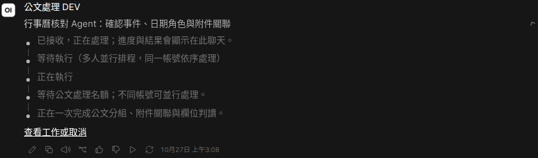
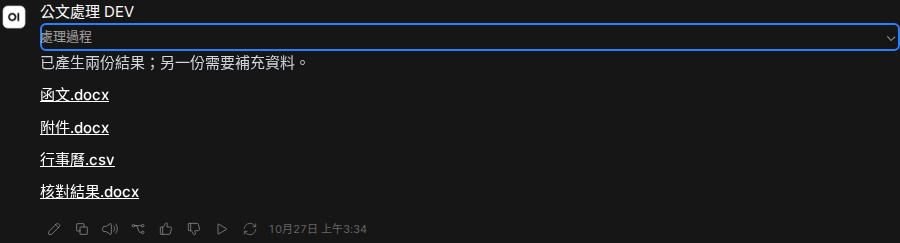
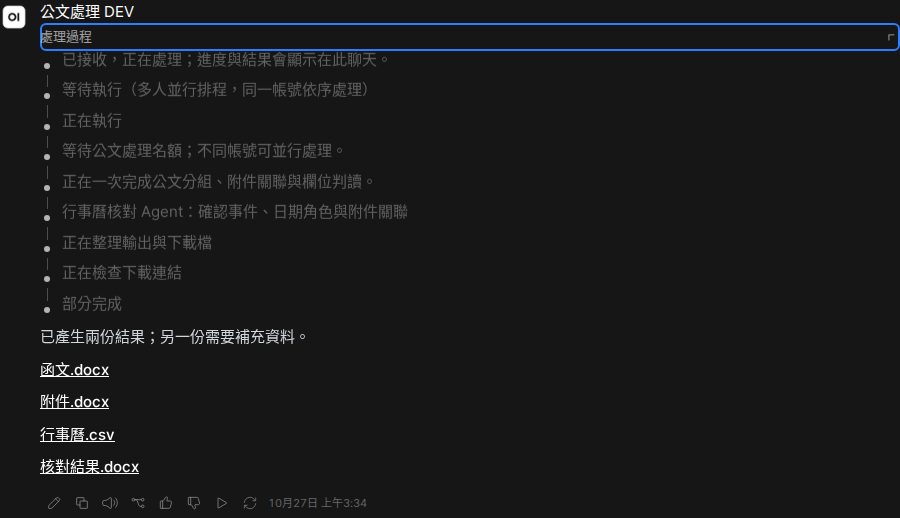

# 聊天處理狀態

預設只顯示最新狀態，右側箭頭可向下展開過往處理步驟。展開時會整理相鄰重複項目，最新狀態保留在上方；
待處理訊息正文的重複狀態會合併顯示，「查看工作或取消」連結保留。
完成後只顯示一份正式結果；上方改為「處理過程」按鈕，預設收合，點擊才顯示過程。
「部分完成」等狀態不再另外重複顯示，結果說明與正文下載連結保持可見。
正文整行隱藏「工作狀態：部分完成」等狀態標題，直接顯示結果說明與下載；最終狀態仍可點擊「處理過程」查看。重新開啟既有聊天也會套用。
完成後隱藏最下方自動附加的「查看工作、下載與確認操作」與「下載檔案 1、2…」連結組，保留結果正文中有檔名的下載連結。

處理中會保留使用者的展開／收合選擇；完成時自動收合一次，之後仍可手動展開。重新載入聊天預設收合。
長狀態在收合時顯示單行，展開後可換行閱讀。保留原生按鈕、鍵盤與 `aria-expanded` 行為。

程式沿用 Open WebUI 0.12.4 的原生 StatusHistory 元件，透過原有的 `/static/loader.js`、`/static/custom.css` 自訂入口載入。
原有自訂 JS／CSS 會保留在回應前段；不修改套件的壓縮前端 bundle，也不刪除資料庫中的狀態紀錄。

| 收合 | 展開 |
| --- | --- |
|  |  |

| 完成後的單一結果 | 點擊查看完成過程 |
| --- | --- |
|  |  |

畫面是 A dev 的獨立驗證聊天，未執行模型或文件工作；測試聊天已移除。

已通過 9 項相關測試，另以真正的 WebUI 聊天頁與原生 socket 事件驗證 10 個情境：
預設收合、點擊展開、相鄰重複整理、即時更新保留展開、鍵盤收合、完成回答顯示與重新載入。
瀏覽器無 JavaScript 錯誤；升級提示只在測試瀏覽器的回應中標示已讀，不改使用者設定。

原生瀏覽器驗證：`tests/status_history_browser.py`（僅允許 A 的獨立 dev 設定）。
驗證紀錄：[dev](../status-history-ui-dev-validation-2026-10-27.json)、[首次部署](../status-history-ui-production-validation-2026-10-27.json)、[完成狀態更新](../status-history-ui-completion-production-validation-2026-10-27.json)。
