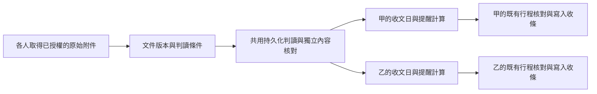

# 公文工作流

安裝、測試與發布統一使用根目錄的 [開發指南](../../CONTRIBUTING.md)。

公文功能集中於本套件，不再保留根目錄的同名套件或相容匯入別名。

| 目錄 | 職責 |
|---|---|
| `api/`、`frontend/` | EIP／上傳工作台路由、生命週期及介面 |
| `application/` | 上傳、EIP 批次、背景工作與階段結果 |
| `domain/` | 文件、日期、行事曆的資料契約與純規則 |
| `services/` | 模型、OCR、輸出與續接服務 |
| `infrastructure/` | EIP／Office adapter、PostgreSQL 儲存 |
| `adapters/` | WebUI Pipe ABI 邊界 |
| `cli/`、[evals/](evals/README.md) | CSV 轉換、收條管理與明確啟用的本機驗收 |
| `deployment/` | OCR 原生設定與 API 部署；不隨服務 wheel 安裝 |

WebUI 組裝與啟動入口在 `examples.openwebui`，共用執行基礎在 `examples.shared.runtime`。
各服務建立時持有依賴；工作流沿用現有部分成功、輸出核對與取消處理契約。
兩個無引用的共用資源／用量相容轉接已刪除，直接引用共用執行套件。

公文 PDF 上傳與 EIP 相同附件的共用處理見 [工作台說明](../../docs/eip-connector.md#相同附件的共用處理)。
應用持有 `SharedContentCache`，服務直接使用既有依賴；以授權後取得的實際內容與處理設定
識別中間結果，透過 PostgreSQL 合併跨使用者、跨 worker 的同時請求。
Office 轉換、原文擷取、OCR 與 Word 內容可共用，每位使用者的輸出與行事曆仍各自登記。
成功產生 CSV 後，可直接開啟 EIP 預覽並確認匯入，無需重新選取 PDF。

## 一次判讀與多人同步

公文上傳、EIP 自動任務及公司助理的公文處理，另使用持久化的 `AnalysisResults`。
同一組原始文件版本、來源內容、模型設定、提示與資料契約，由 PostgreSQL 協調一個
模型請求；其他已獲來源授權的使用者等待或沿用結果。檔名、私人上傳 ID、EIP flow ID
與收文日期不決定共用內容，也不能代替每人的來源授權。



共用內容包含分組、文件欄位、相對期間規格、內容語意與準備建議核對；模型輸出須先
通過回應資料契約，每位使用者仍執行原文證據與個人日期驗證。相對期限由程式分別
依本人已驗證收文日期計算，不把某人的日期、私人行事曆或寫入成功狀態分享給別人。
每人的帳號授權、CSV／下載、遠端既有行程核對、確認或自動同步同意及寫入收條各自保留。
此流程沿用每人既有的同步任務，不新增可指定其他人帳號或代替別人授權的入口。

成功判讀不隨七天的可重建內容快取到期，也不因一般服務重啟重新付費；原始文件版本、
模型／參數、提示或契約改變時才建立另一筆判讀。單次分析可包含主要分析、獨立核對及
長文件分段等多個模型請求，每個相同階段各自共用。不同附件組合與不同計費連線的
判讀不強行混用。公司助理首次呼叫仍扣實際呼叫者既有額度；共用命中不呼叫模型，
不新增模型次數或虛構用量，也不改用公文服務的免扣額度金鑰。

共用紀錄也保存當時完整的原文與結構行號，防止 OCR 再執行時的分行差異使同一份
公文變成另一個模型輸入。之後的收件者先驗證實際來源版本，再沿用這份原文依據；
每人的頁數及文字容量限制仍檢查。修改抽取或判讀語意時須更新相應契約識別，
一般介面、服務入口或部署調整不要求重跑已保存的判讀。

Schema 11 增加 `document_analysis_results`、`document_analysis_uses` 與
`document_analysis_resolutions`，保留既有任務、加密金鑰及行事曆收條。
成功輸出與待核對的付費開始紀錄均不自動清除；若模型逾時、中斷或結果未能保存，
後續使用者不會自動重送。已有結果損壞也停止重新付費。明確未接受的請求採短暫退避。
操作員可檢視不含公文原文的紀錄：

```bash
ai-gateway exec webui -- python -m examples.official_document_workflow.cli.analysis_records list --state unknown
```

只有已由模型端／傳輸紀錄證明「請求確實未開始」時，才可使用
`confirm-not-started --scope SCOPE --key KEY --actor OPERATOR --reason EVIDENCE`。
工具會拒絕執行中的或已成功的判讀，並保存核對理由與原始收條雜湊；此命令本身不呼叫模型。
單純逾時不是未開始的證據，不能透過清空資料表或修改到期時間繞過待核對狀態。

Docker 建置與 profiles 統一在根目錄，Office／CAD 各自使用獨立映像。
Office 轉 PDF 的建置命令為 `docker build --target eip-office -t ai-gateway/eip-office:1 .`；
OCR 使用 `ai-gateway compose ocr up -d`，仍需搭配 PaddleX API。
設定與完整操作見 [部署工具](../deployment/README.md#docker-入口)及
[OCR 服務](../../docs/paddleocr-vl-service.md)。

```bash
ai-gateway exec webui -- python -m examples.openwebui.serve
python -m examples.official_document_workflow.cli.prepare_calendar_csv --help
python -m examples.official_document_workflow.evals.sample_corpus --help
```

搬移不會修改正式資料庫或正在運行的服務。更新既有部署時，須同步安裝新套件、
Function 原始碼與部署設定；歷史 JSON 驗收紀錄保留當時路徑，不作為目前操作入口。
